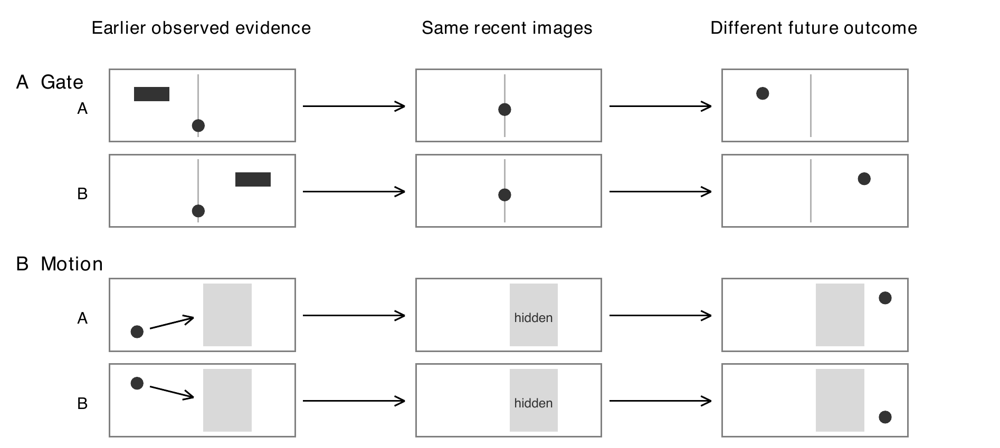

# Bounded Visual Memory

Code, experimental protocols, numerical results, figures, and reports for a controlled visual-memory research project.

**Research question:** when memory is limited, can the prediction error caused by deleting an observation provide a useful signal for deciding what to retain?

This repository reports an **I-JEPA prototype**, not a V-JEPA experiment. It contains substantial but uneven mechanism evidence. The previous strict two-task Phase One acceptance protocol was **not met**; no learned retention policy or fresh independent confirmation has been demonstrated. Failed and incomplete experiments remain available.

## Start here

- [English academic report with figures](reports/Phase1_Report.docx)
- [Black and white PDF verified after Google Docs transfer](reports/Phase1_Report.pdf)
- [Google Doc](https://docs.google.com/document/d/1ZCtgzUOKNq6hlM-S1oZU7n7mHoKquX8HOkIPk--3hOs)
- [Experimental design and test definitions](docs/EXPERIMENTS.md)
- [Results and interpretation](docs/RESULTS.md)
- [Reproduction instructions](docs/REPRODUCIBILITY.md)
- [Publication contents and external artifacts](docs/PUBLICATION_SCOPE.md)



The drawing explains the task idea. It is not an actual test frame or a model prediction.

## Current evidence

| Test | Gate | Motion |
|---|---:|---:|
| Historical evidence readable from features | 3/3 pass | 3/3 pass |
| Historical evidence improves prediction | 23/24 pass | 8/24 pass |
| Forecast responds to swapped historical content | 24/24 pass | 24/24 pass |
| Additional fixed-reference checks | 32/32 pass | 8/32 pass |
| Critical deletion contrasts at equal capacity | 6/18 pass | 36/36 pass |
| Cross-horizon deletion checks | 18/18 pass | 18/18 pass |
| Learned retention advantage | Not run | Not run |
| Fresh independent confirmation | Not run | Not run |

These are coverage counts of specified comparisons, not independent dataset counts or probabilities that the proposal works. Some include both individual seeds and their mean. Other warnings lie outside these denominators; see the report. A majority of checks does not retrospectively replace the registered acceptance rules.

Motion supplies a consistent relative deletion signal in the examined pools, despite limited absolute prediction quality under long occlusion. Gate has broad prediction support but weaker deletion stability. The deletion assay permits only a scoped Motion feasibility interpretation; the registered **joint policy-stage readiness rule remains unmet**.

## Repository structure

```text
phase1_jepa_memory/
  src/phase1/                  Shared simulators, encoders, predictors, evaluation
  configs/                     Experiment configurations
  tests/                       Existing software checks
  runs/                        Frozen experiment snapshots and local result records
    phase1_proposal_validation/ Initial complete proposal validation
    phase1_predictor_repair*/   Repairs, diagnostics, and negative/partial outcomes
    phase1_deletion_assay/      Equal-capacity deletion assay and audited results
  far_*/                       Historical FAR experiments, separate from proposal claims
  paper_reproduction/          Historical reproduction adapters and records
docs/                          Design, results, provenance, reproduction guide
reports/                       Latest report and scientific figures
tools/                         CPU-only result verification and report rebuilding
publication/                   File hashes and explicit exclusion inventory
```

`phase1_jepa_memory/README.md` is the original chronological laboratory log. Its older RUNNING/PENDING entries are historical snapshots, not current jobs or instructions to reconnect. Use this README and the final result files for the published interpretation.

## Verify the published results without training

```bash
python -m pip install -r requirements-results.txt
python tools/verify_results.py
```

The verifier checks file hashes, recomputes **180 deletion-effect statistics** from the 11,520 transferred pair-level scalar rows, and checks the reported coverage. It does not download weights, encode images, train a model, or submit HPC jobs.

For the original experimental package:

```bash
python -m pip install -e ./phase1_jepa_memory
phase1 --help
```

Full forward evaluation or training also needs the external checkpoint and cache assets documented in [reproducibility](docs/REPRODUCIBILITY.md). Installation or a software check is not a new scientific result.

## Provenance and scope

The copied scientific source and result files are byte-identical to the local snapshot, with SHA-256 records in [the publication manifest](publication/source_and_results_manifest.json). Large model/cache arrays and raw HPC-only artifacts are not silently claimed to be included. Their recorded identities remain in the original asset ledgers. Upstream checkouts are pinned in [third-party provenance](docs/THIRD_PARTY.md).

The original proposal-validation/repair GPU ledger records **12,723 seconds** under the authorized cumulative 28,800-second cap. The deletion assay used existing models with **zero additional GPU seconds**. Separate historical FAR work is not part of that ledger.
