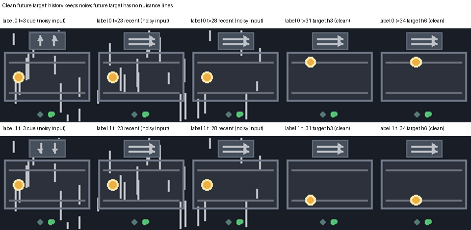

# Bounded Visual Memory: Gate Retention Study

This project studies how a model with limited visual memory can preserve observations that matter for predicting the future. The current stage uses a controlled, synthetic **Gate** task to examine two questions:

1. Does retaining a key visual cue help the frozen model predict what happens next?
2. How do online memory-retention policies compare on the same task and memory budget?

The current study is an exploratory comparison on a simple task. Its results do not depend on passing the earlier Phase 1 gate, and they do not change the historical evaluation.

## The Gate task and data

An episode contains a direction cue represented by pale-gray arrows, a sequence of frames with randomly distributed vertical-line distractions, and a future route or state to predict. The cue can occur at different positions in the history. Input frames contain the distractions; future prediction targets are rendered without them. Paired scenes share actions and nuisance patterns while varying the cue and corresponding future.

The latest comparison reuses the existing encoded train/validation data: **1,024 training episodes and 192 validation episodes**. Each policy has two history slots (B = 2) and receives the same four recent frames, with the same frozen encoder and predictor. On arrival, a policy can retain only two of its two stored history frames and the new frame; a discarded frame cannot return.

[Data generation and configuration](docs/GATE_RETENTION_COMPARISON_LATEST.md#data-design) · [Dataset preflight](results/gate_retention_comparison_20261029/data_preflight.json)

## Current validation comparison

The table aggregates the 192 validation episodes across three predictor seeds and two horizons. These repeated measurements are not independent examples. Cue hit means at least one retained history frame is in the cue interval; it is separate from route/state prediction accuracy.

| Retention method | Route/state accuracy | Cue hit | Normalized latent MSE ↓ |
|---|---:|---:|---:|
| Manual keyframe reference* | 95.57% | 100.00% | 0.09783 |
| Deletion-cost scorer | 94.53% | 100.00% | 0.09934 |
| Visual diversity | 71.79% | 47.40% | 0.11385 |
| Prediction surprise | 66.15% | 34.55% | 0.11765 |
| Reservoir | 57.38% | 16.84% | 0.12362 |
| Temporal buckets | 56.60% | 15.62% | 0.12256 |
| FIFO | 56.51% | 13.54% | 0.12423 |
| Feature-attention-proxy scorer | 56.08% | 13.72% | 0.12332 |
| Recent frames only | 50.00% | 0.00% | 0.12497 |

\* Manual keyframe selection is a privileged diagnostic reference: it knows the cue position. Its advantage over the recent-only control supports the usefulness of cue-containing history **in this setting**, but is not by itself a general causal or independent-test guarantee. The two learned scorers have the same architecture and student training budget, but their teacher signals and preparation costs differ. The deletion-cost teacher uses the frozen predictor and future targets during training; it is therefore predictor-aligned. No future information or cue labels are used by the learned students during online selection.

The retired task-trained attention method is excluded from the current table. Historical code and records remain available for provenance.

[Full result and fairness details](docs/GATE_RETENTION_COMPARISON_LATEST.md) · [Chinese result summary](results/gate_retention_comparison_20261029/RESULTS_ZH.md) · [Machine-readable results](results/gate_retention_comparison_20261029/summary.json)

## Model and code

- Frozen encoder and predictor: reused across the comparison; no predictor retraining for the policy comparison.
- New scorers: matched 45,633-parameter models, trained for 1,000 updates per arm and seed using seeds 17, 29 and 43.
- [Scorer implementation and protocol](experiments/gate_supervision_comparison_design_v2/README.md) · [Data generator](experiments/gate_clean_future/materialize.py) · [Teacher signals](experiments/gate_supervision_comparison_design_v2/teachers.py)

These are **validation-set** results, not a new independent test. The new scorer weights, encoded features and complete raw validation output are not included in this repository; the saved HPC paths are provenance and are not public download links. The exact historical runner still contains HPC-specific paths. See the full result document for audit details and reproducibility limits.

## Next stage

The next research stage can extend this comparison to **Motion and more complex simulated scenes**, where relevant information may unfold over time and require multiple observations. This is a future direction, not a completed result of the current Gate study.
