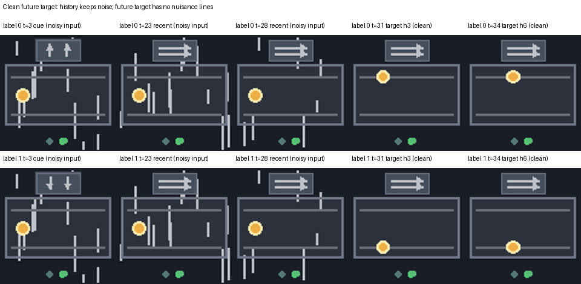

# Bounded Visual Memory: Gate Retention Study

This project studies how a model with limited visual memory can preserve observations that matter for predicting the future. The current stage uses a controlled, synthetic **Gate** task to examine two questions:

1. Does retaining a key visual cue help the frozen model predict what happens next?
2. How do online memory-retention policies compare on the same task and memory budget?

The current study is an exploratory comparison on a simple task. Its results do not depend on passing the earlier Phase 1 gate, and they do not change the historical evaluation.

## The Gate task and data

An episode contains a direction cue represented by pale-gray arrows, a sequence of frames with randomly distributed vertical-line distractions, and a future route or state to predict. The cue can occur at different positions in the history. Input frames contain the distractions; future prediction targets are rendered without them. Paired scenes share actions and nuisance patterns while varying the cue and corresponding future.

The latest comparison reuses the existing encoded train/validation data: **1,024 training episodes and 192 validation episodes**. Each policy has two history slots (B = 2) and receives the same four recent frames, with the same frozen encoder and predictor. On arrival, a policy can retain only two of its two stored history frames and the new frame; a discarded frame cannot return.

[Data generation and configuration](docs/GATE_RETENTION_COMPARISON_LATEST.md#data-design) · [Dataset preflight](results/gate_retention_comparison_20261029/data_preflight.json)

## Current validation comparison

The table aggregates the 192 validation episodes across three predictor seeds and two horizons. These repeated measurements are not independent examples. Cue hit means at least one retained history frame is in the cue interval; it is separate from route/state prediction accuracy.

| Retention method | Route/state accuracy | Cue hit | Normalized latent MSE ↓ |
|---|---:|---:|---:|
| Manual keyframe reference* | 95.57% | 100.00% | 0.09783 |
| Deletion-cost scorer | 94.53% | 100.00% | 0.09934 |
| Visual diversity | 71.79% | 47.40% | 0.11385 |
| Prediction surprise | 66.15% | 34.55% | 0.11765 |
| Reservoir | 57.38% | 16.84% | 0.12362 |
| Temporal buckets | 56.60% | 15.62% | 0.12256 |
| FIFO | 56.51% | 13.54% | 0.12423 |
| Feature-attention-proxy scorer | 56.08% | 13.72% | 0.12332 |
| Recent frames only | 50.00% | 0.00% | 0.12497 |

\* Manual keyframe selection is a privileged diagnostic reference: it knows the cue position. Its advantage over the recent-only control supports the usefulness of cue-containing history **in this setting**, but is not by itself a general causal or independent-test guarantee. The two learned scorers have the same architecture and student training budget, but their teacher signals and preparation costs differ. The deletion-cost teacher uses the frozen predictor and future targets during training; it is therefore predictor-aligned. No future information or cue labels are used by the learned students during online selection.

The retired task-trained attention method is excluded from the current table. Historical code and records remain available for provenance.

[Full result and fairness details](docs/GATE_RETENTION_COMPARISON_LATEST.md) · [Chinese result summary](results/gate_retention_comparison_20261029/RESULTS_ZH.md) · [Machine-readable results](results/gate_retention_comparison_20261029/summary.json)

## Code map: reproduce the Gate study

### Team model and data downloads

- [Private Gate model bundle](https://huggingface.co/cv-project-team5guys/gate-retention-models-v1) — three frozen predictors, both new scorers for seeds 17/29/43, transforms, probes, checksums and portable loading examples.
- [Private Gate train/validation dataset](https://huggingface.co/datasets/cv-project-team5guys/gate-clean-future-trainval-v1) — the 1,216 episodes, matching feature cache, original validation output and per-file checksums.

An organization member must grant your Hugging Face account access before either private link works. The bundles were downloaded again and their checksums verified; a real validation-episode loading and inference example ran successfully. These are validation artifacts, not a fresh independent test. Official I-JEPA pretrained encoder weights are not redistributed.

The links below follow the experiment flow. The original course-HPC batch launchers retain their historical paths and are **not portable launchers**; use the download and loading instructions in the model and dataset repositories. `/scratch/xl4358/...` paths in historical records are provenance, not required teammate paths.

### 1. Generate and check the data

- [Clean-future dataset generator](experiments/gate_clean_future/materialize.py): builds paired Gate episodes with noisy input frames and clean future targets.
- [Structured scene and distraction design](experiments/retention_structured_noise_audit/structured_design.py) · [cue-position/noise utilities](experiments/retention_position_noise_audit/design.py): scene and augmentation rules used by the generator.
- [Dataset configuration template](results/gate_retention_comparison_20261029/dataset_config_template.json) · [train/validation protocol](experiments/gate_clean_future/protocol.json) · [preflight checks](experiments/retention_structured_noise_audit/clean_future_preflight.py) · [recorded preflight results](results/gate_retention_comparison_20261029/data_preflight.json). The configuration is a readable path-adjusted template, not a byte-identical copy of the HPC resolved configuration.

### 2. Encode frames and train the future predictor

The October 22 clean-future run uses its [frozen predictor-source snapshot](experiments/gate_clean_future/frozen_control/README.md). The older Phase 1 control source is retained separately for its historical results and source lock. Run `python tools/verify_gate_clean_future_source.py` to check the 53 recorded source files.

- [Feature encoding and train-only transforms](experiments/gate_clean_future/fit_features.py) · [encoder cache implementation](experiments/predictor/control/src/phase1/cache.py).
- [Predictor architecture and projection](experiments/predictor/control/src/phase1/model.py) · [training and checkpointing](experiments/predictor/control/src/phase1/training.py) · [three-seed training entry point](experiments/retention_structured_noise_audit/train_reference.py).
- [Original train/validation batch launcher](experiments/gate_clean_future/run_trainval.sbatch) · [predictor validation](experiments/gate_clean_future/evaluate_validation.py). The recorded validation used this [per-sibling bookkeeping repair](results/retention_structured_noise_audit/clean_future_evaluation_repair_20261022/evaluate_each_sibling.py); preserve its behavior when reproducing that validation. It is an HPC-specific execution snapshot.
- [Frozen clean-future source checksums](experiments/retention_structured_noise_audit/clean_future_source_lock.json) · [clean-future protocol](experiments/gate_clean_future/protocol.json).

### 3. Train the two new retention scorers

- [Scorer architecture and matched initialization](experiments/gate_supervision_comparison_design_v2/core.py).
- [Teacher definitions](experiments/gate_supervision_comparison_design_v2/teachers.py) · [teacher-label preparation](experiments/gate_supervision_comparison_design_v2/teacher_stage.py) · [matched checkpointed training](experiments/gate_supervision_comparison_design_v2/checkpoint_fit.py).
- [Train/validation runner](experiments/gate_supervision_comparison_design_v2/run_trainval.py) · [original training batch script](experiments/gate_supervision_comparison_design_v2/train.sbatch) · [experiment protocol](experiments/gate_supervision_comparison_design_v2/PROTOCOL.md) · [execution amendment](experiments/gate_supervision_comparison_design_v2/EXECUTION_AMENDMENT_20261029.md). The protocol contains its original pre-run wording; the [package README](experiments/gate_supervision_comparison_design_v2/README.md) explains the completed run.

### 4. Run and inspect the policy comparison

- [Online B=2 update rules](experiments/gate_retention_comparison_v1/online.py) · [baseline policy implementations](experiments/retention_online_matrix/policies.py).
- [Policy validation and trace checks](experiments/gate_supervision_comparison_design_v2/validation.py) · [original validation batch script](experiments/gate_supervision_comparison_design_v2/validate.sbatch) · [independent validation-audit snapshot](results/gate_retention_comparison_20261029/audit_validation_hpc_snapshot.py).
- [Results and fairness details](docs/GATE_RETENTION_COMPARISON_LATEST.md) · [Chinese result summary](results/gate_retention_comparison_20261029/RESULTS_ZH.md) · [machine-readable summary](results/gate_retention_comparison_20261029/summary.json).
- [Scorer software tests](experiments/gate_supervision_comparison_design_v2/test_v2.py) · [data-protocol tests](experiments/gate_clean_future/test_protocol.py). These are software checks, not new scientific results.

The historical validation code also computed the retired task-trained attention comparator. It is preserved for provenance and omitted from the latest results table. The reported comparison is on the existing validation set, not a new independent test.

## Set-structure retention, reader diagnostics and PushT preparation (20–26 October 2026)

This separate development track (merged from PR #1) tests the proposal's set-conditioned claim: whether deletion-cost supervision helps when evidence is redundant, decoyed, or only useful jointly. It uses its own synthetic data, readers and students; its results are not part of the Gate table above and do not change the formal Phase 1 decision.

- **Locked confirmation (26 October, seed 20261104, 48 families).** On the synergy task, a set-conditioned deletion-cost student lost necessary evidence in 4.59% (multihead reader) and 0.65% (item-attention reader) of cases, versus 35.89% / 37.80% for full-set sensitivity, 70.27% / 55.12% for head-averaged attention, and 67.38% / 56.29% for a matched future-attention student. All three preregistered claims passed. Limits: the redundancy-task student does not generalize, the decoy task admits an appearance shortcut, each reader has one training seed, and uniform/diversity baselines were not computed on this confirmation set. [Confirmation record](results/literature_diagnosis/qualified-reader-retention-20261025/conf/README.md) · [development report](docs/QUALIFIED_READER_RETENTION_DEV_ZH.md)
- **Reader qualification.** The original reader failed preregistered redundancy/decoy checks; multihead and item-attention readers passed all K2/K3 gates. [Three-structure report](docs/TERMINAL_THREE_STRUCTURES_REPORT_ZH.md) · [reader aggregation results](docs/READER_AGGREGATION_RESULTS_ZH.md)
- **Negative and diagnostic results.** On the 23 October locked Gate confirmation, a masked deletion-cost linear probe did not beat its shuffled-label control. Some oracles delete the cue to lower feature MSE, and use-time labels fix that ranking without improving the student. [Literature-baseline fresh report](docs/LITERATURE_BASELINE_FRESH_REPORT.md) · [oracle diagnosis](docs/BASELINE_ORACLE_DIAGNOSIS_20261022.md) · [Gate confirmation and casebook](docs/GATE_CONFIRMATION_AND_CASEBOOK.md) · [use-time probe](docs/GATE_USE_TIME_PROBE.md)
- **Predictor history use.** [History diagnosis](docs/PHASE2_HISTORY_DIAGNOSIS.md): Gate gains useful history dependence without input whitening; Motion shows no net history benefit.
- **PushT.** [Interface](docs/PHASE2_PUSHT.md) and [48-episode occluded/unoccluded corpus](docs/PHASE2_PUSHT_PLANNING_PREPARATION.md). Superseded by the hidden-CoG PushT study below.

## PushT with a hidden centre of gravity (November 2026)

Plain PushT needs no memory: the block moves only while pushed (zero damping) and actions are absolute pusher targets, so the present frame and the actions determine the future. We hide a **discrete centre of gravity** (left, centre or right; body-local (−40, 20), (0, 45), (40, 20)) in the T block. The block looks the same in every class, but a later **test push** on the crossbar turns it differently, so predicting the future needs a past cue. The PushT end goal is planning; this stage evaluates latent prediction and retention. Full write-up: [docs/PUSHT_COG_CUE.md](docs/PUSHT_COG_CUE.md).

**Setups.** A *family* is one scenario run once per class (three *siblings*). The model sees the 4-frame present (query−3 … query) plus B = 2 retained history frames; the target is the I-JEPA latent at query + 12.

| Version | Cue | Status |
|---|---|---|
| **v5c** | the CoG drawn as a red dot (radius 4 px at 96×96) on the block for 3 early frames, plus 1–2 distractor dots (palette including the marker red) on empty background in every history frame | **main testbed** |
| v5b | the same dot without distractors | the dot is the most salient frame, so visual diversity finds it |
| v5 | a 2-px dot | too faint in I-JEPA features |
| v4 | no symbol: the block's response to a shared probe push, read against the present | harder follow-up |
| v1–v3 | scene cut / calibrated starts / matched probes | kept for provenance |

In v5–v5c no frame is touched until the test push and all actions are shared, so siblings differ only in the marker frames: the present carries **no** class information (probes at exactly 1/3) and the future depends strongly on the class (query + target probe 0.99).

**Predictor** ([train_pusht_cog_predictor.py](experiments/phase2/train_pusht_cog_predictor.py)). Predicts standardized I-JEPA latents at +6/+12 from the present, up to two history slots (latent, age, pusher target) and future absolute pusher targets, through a 128-dim input basis that includes sibling frame differences (so the faint marker direction is kept). Trained with random memory conditions so one model serves every policy. It needed data: with 128 training families keeping the marker lowered the +12 error only 7%; with **960** families, 39% (sibling identification 0.33 → 0.91).

**Retention** ([retention_pusht_cog.py](experiments/phase2/retention_pusht_cog.py)). Online B = 2 memory; baselines use the repo's audited Gate rules. The deletion-cost scorer is Gate v2's set-conditioned student with a **target-time teacher** (each deletion scored by the frozen predictor's error at the episode's +6/+12 targets) and **training states along whole rollouts**, followed by two **DAgger** rounds. Validation (96 episodes), mean of 3 seeds, 960 training families; error is the mean squared error over 5,120 standardized features, sibling ID is how often the prediction is closest to its own sibling's future (chance 1/3):

| Policy | v5b: +12 error / sibling ID / marker kept | **v5c (distractors): +12 error / sibling ID / marker kept** |
|---|---|---|
| Recent only | 0.810 / 0.33 / 0% | 0.743 / 0.33 / 0% |
| FIFO | 0.810 / 0.33 / 0% | 0.743 / 0.33 / 0% |
| Temporal buckets | 0.810 / 0.33 / 0% | 0.744 / 0.33 / 0% |
| Random deletion | 0.810 / 0.34 / 0% | 0.745 / 0.33 / 0% |
| Reservoir | 0.764 / 0.41 / 13% | 0.702 / 0.40 / 13% |
| Visual diversity | 0.498 / 0.89 / 99% | 0.618 / 0.57 / 44% |
| **Deletion-cost scorer** | **0.501 / 0.90 / 100%** | **0.473 / 0.87 / 99.7%** |
| Marker frames (privileged reference) | 0.499 / 0.90 / 100% | 0.474 / 0.86 / 100% |

On v5c the deletion-cost scorer keeps a marker frame in 287 of 288 episode runs (96 episodes × 3 seeds; one miss in seed 43; all 288 on v5b) and matches the privileged reference; visual diversity, which tied it on v5b, falls to 44% once distractors make other frames just as distinctive. It matches the reference because one marker frame carries almost all the value: the reference is a fixed rule (first and last marker frames), not the best possible memory, and with a single marker frame in memory the error is within ±0.02 of the reference's two. The scorer keeps two marker frames in ~73% of episodes and one marker plus another frame in ~26% (see [docs/PUSHT_COG_CUE.md](docs/PUSHT_COG_CUE.md)).

**Why the deletion-cost scorer works here** (from the implementation):
1. *The teacher measures what matters.* The predictor's +12 error depends almost only on whether a marker frame is in memory (0.47 with, 0.74 without), so deleting the marker is costly and deleting anything else is nearly free: a clear, consistent label.
2. *It is prediction-aligned, not salience-driven.* The predictor learned to ignore distractor dots (they never appear in targets and keeping them never lowers error), so the teacher never rewards them; visual diversity measures feature spread, which distractors inflate.
3. *Target-time credit.* The marker arrives ~40 frames before the query; scoring every decision at the episode's target (not the near future) gives it its true value when the decision is made, the use-time fix Gate also needed.
4. *The right training states.* Every baseline rollout passes the step where the marker arrives, so that decision is labelled in every episode; DAgger adds the student's own "hold the marker against each new frame" states, which it must get right ~40 times per episode.
5. *Set-conditioned scoring* judges each candidate relative to the other two, and once one marker frame is kept the second slot barely matters, so the scorer reaches the reference exactly.

Caveats: the teacher uses the frozen predictor and true future latents at training time (run-time inputs are past frames and actions only); the input basis uses the dataset's sibling pairing; v5c's cue fits in one frame, whereas v4's is relational; all numbers are on validation, and the evaluation split is untouched.

**Code and data.** Generators [pusht_cog_marker.py](experiments/phase2/pusht_cog_marker.py) and [prepare_pusht_cog_marker_data.py](experiments/phase2/prepare_pusht_cog_marker_data.py) (`--marker-radius`, `--train-families`, `--distractor-dots`); encoding and probes [probe_pusht_cog_features.py](experiments/phase2/probe_pusht_cog_features.py); Slurm scripts in [experiments/phase2/slurm/](experiments/phase2/slurm/); results JSON in [results/pusht_cog/](results/pusht_cog/). Corpora and features are not in Git; they regenerate in minutes on CPU (encoding ~40 min on an H200).

**Next:** v4 with the same pipeline (the cue is a push and its response, which tests set conditioning and DAgger harder), then planning with the learned predictor.

## Next stage

The next research stage can extend this comparison to **Motion and more complex simulated scenes**, where relevant information may unfold over time and require multiple observations. This is a future direction, not a completed result of the current Gate study.
