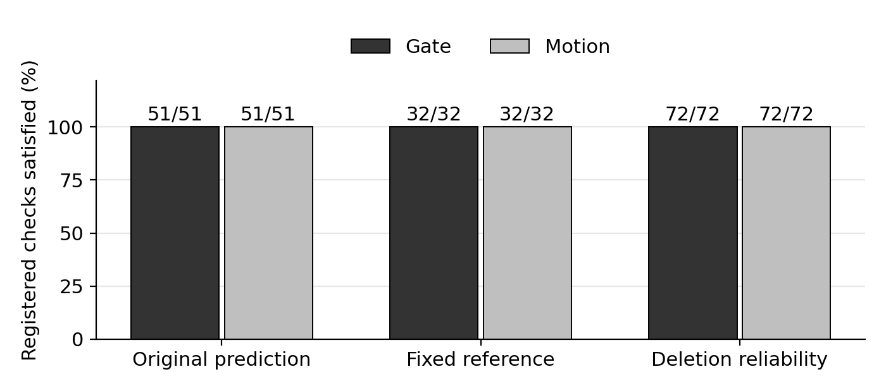

# Bounded Visual Memory

Can the prediction error caused by deleting an observation help decide what a limited visual memory should retain?

## Predictor diagnosis and independent continuation — 20 October 2026

The original four-epoch predictors depended on history but did not benefit from it
on validation. A fixed CPU follow-up now identifies a useful **Gate development
candidate** after removing input whitening; **Motion still lacks a net history
benefit**. These are newly trained models, separate from the teammate's missing
final repaired checkpoints.

- **Why validation worsened:** the paired training objective can improve while
  ordinary MSE worsens. In Gate, whitening also amplified directions almost absent
  from training: 81/128 coordinates contributed 78% of validation projected energy.
  Training-only masking reduced this harm but did not recover useful history.
- **Fixed follow-up completed:** three projection arms × two tasks × 40 epochs,
  with the same architecture, output basis, objective and seed. Checkpoint selection
  includes epoch zero. Gate's no-whitening arm selected epoch 35 and reduced
  six-sampler validation MSE from 0.105936 to 0.097827. Correct privileged K=2
  history scored 0.074275 versus recent-only 0.102571; wrong sibling history scored
  0.196949. Motion's correct-history condition still did not beat recent-only.
- **Gate Phase 2 continuation executed:** the new checkpoint was explicitly bound
  to six online baselines (48 episode/policy rows, 96 horizon losses) and fresh
  deletion supervision (94 train + 24 validation parents, 354 equal-K forks,
  708 losses). All losses were independently checked from saved predictions.
  Diversity and attention are strong baselines on this development split.
- **Independent PushT corpus prepared:** 48 episodes, split 32/8/8, with 4,656
  frames per masked/unmasked variant. Absolute XY actions remain ordered, and
  masking occurs before encoding. This completes data preparation, not baseline
  model planning or history-necessity validation.
- **Final checks:** 229 tests passed with zero failures, errors or skips, plus
  dependency checks, both historical evidence verifiers and the real PushT
  interface. `python tools/verify_phase2_history.py` verifies the published
  diagnosis receipts and arithmetic without rerunning models.

The Gate control improvement uses four repeatedly inspected validation pairs and
privileged evidence. It is **not learned-retention performance or an independent
generalization result**. The new runs use CPU and existing downloaded I-JEPA
features; they do not consume another A100 allocation. Original snapshots remain
unchanged, and no test arrays were opened in predictor diagnosis or follow-up.

[Diagnosis, controls and reproduction](docs/PHASE2_HISTORY_DIAGNOSIS.md) ·
[Gate baseline and deletion continuation](docs/PHASE2_GATE_FOLLOWUP_CONTINUATION.md) ·
[PushT preparation and remaining planning work](docs/PHASE2_PUSHT_PLANNING_PREPARATION.md) ·
[Portable evidence](results/phase2_history/20261020)

## Phase 2 development execution — 20 October 2026

A separate, newly initialized development run now implements the proposal's bounded memory interface, varied-history training with memory dropout, and frozen equal-capacity deletion supervision. It uses the retained source and official frozen I-JEPA, without claiming to reproduce the missing latest repaired Phase 1 models.

- **Actual A100 execution completed:** job 9285, A100-SXM4-40GB with matching physical UUID, 169 allocated GPU seconds. Real PushT interface encoding and 128 new controlled Gate/Motion episodes / 3,616 frames passed interface and sample checks.
- **New Gate/Motion CPU predictors trained:** four epochs each with parameter updates and exact frozen validation replay. Validation was slightly worse than initialization; no quality improvement is claimed.
- **Deletion pilot completed:** 238 distinct streaming parents (190 train / 48 validation), 714 equal-K forks and 1,428 finite multi-horizon loss values. This is development supervision, not a trained retention scorer or model-driven planning result.
- **Six retention baselines executed:** FIFO, reservoir, temporal buckets, visual diversity, prediction surprise and attention produced 96 episode/policy rows and 192 horizon losses on 16 validation episodes (eight independent pairs). This small, reused-validation pilot is not a generalization result; total auxiliary memory bytes differ between policies.
- **Software checks at that snapshot:** 181 tests passed with no failures, errors or skips. All task compute sessions ended, and full new data/model and baseline-result backups were downloaded and hash-verified.

[Execution evidence](docs/PHASE2_HPC_RUN.md) · [Training contract](docs/PHASE2_PREDICTOR_PILOT.md) · [Deletion pilot](docs/PHASE2_DELETION_PILOT.md) · [Six-policy pilot](docs/PHASE2_RETENTION_BASELINE_PILOT.md) · [Missing original assets](docs/PHASE1_HANDOFF_CHECKLIST_ZH.md)

The older report and GPU ledger below describe the original study and are preserved separately. Its additional `Phase1_GO` criteria are not new prerequisites imposed on the proposal's Phase 2.

## Latest verified status — 19 October 2026

**Development checks are satisfied for both tasks. Full Phase1_GO remains unestablished: fresh independent confirmation did not run. No retention policy has been trained.**

| Registered checks satisfied | Gate | Motion |
|---|---:|---:|
| Original prediction requirements | 51/51 | 51/51 |
| Additional fixed-reference requirements | 32/32 | 32/32 |
| Task-specific deletion diagnostics | 72/72 | 72/72 |

Counts are correlated registered comparisons, not independent trials or prediction-accuracy percentages. Gate's deletion count measures critical-versus-other deletion contrasts; Motion's measures cross-horizon, future-informed oracle comparisons. Neither establishes a deployable retention policy. Development data have been repeatedly inspected.



Gate's complete temporal-extrapolation contribution was disabled. Motion uses frozen-reference visual prediction plus guarded position and a fixed equal-weight training-only observation-innovation map. Neural predictors remained frozen during this final repair; two small maps were fitted. All original thresholds were retained. This is a controlled synthetic **I-JEPA** prototype, not a V-JEPA or real-video confirmation.

[Full result explanation and limitations](docs/PHASE1_LATEST.md) · [Illustrated English Word report](reports/independent_confirmation_boundary/Phase1_Confirmation_Review.docx) · [Published evidence manifest](results/phase1_latest/manifest.json)

## Independent confirmation and GPU accounting

CPU execution equivalence passed, but fresh seed 9137 was never generated or accessed: **0/12 new neural models and 0/2 new maps**. A failed startup job underwent 56 automatic requeues, creating 57 GPU allocation records without entering the experiment script. Cumulative GPU allocation reached **39,651 seconds (11 h 00 m 51 s)** against the approved **28,800 seconds (8 h)**, an excess of **10,851 seconds (3 h 00 m 51 s)**.

The agent's execution guard failed to cover configuration and automatic requeue stages. This is an execution-protection failure, not a fresh scientific rejection. All compute tasks are ended, the temporary evidence node was released, and monitoring was deleted. New GPU submissions are stopped under the exhausted budget.

[Native accounting](results/phase1_latest/budget_boundary.json) · [57 allocation records](results/phase1_latest/startup_allocations.csv) · [Independent accounting replay](results/phase1_latest/budget_local_audit.json)

## Verify the published update

```bash
python tools/verify_phase1_latest.py
```

This standard-library-only check verifies the evidence hashes, registered comparison counts, allocation durations and final status. It does not run models, use a GPU or replace the original raw-data audits. Detailed per-comparison estimates and confidence intervals are in the [Gate](results/phase1_latest/gate_summary.json) and [Motion](results/phase1_latest/motion_summary.json) evidence.

## Existing implementation and earlier study

The repository also retains the frozen predictor, equal-capacity deletion assay and earlier numerical evidence. The original report and results below describe the earlier baseline; use the dated update above for the current status.

- [Experimental design and test definitions](docs/EXPERIMENTS.md)
- [Earlier baseline results](docs/RESULTS.md)
- [Earlier illustrated report](reports/Phase1_Report.pdf)
- [Reproduction and external assets](docs/REPRODUCIBILITY.md)

```bash
python -m pip install -r requirements.txt
python tools/verify_results.py
python -m pytest -q experiments/deletion/test_assay.py
```

Those commands verify the earlier retained evidence and assay software. Model weights, encoded arrays and large raw artifacts remain external HPC assets. No historical Slurm allocation or SSH endpoint is a live connection.
