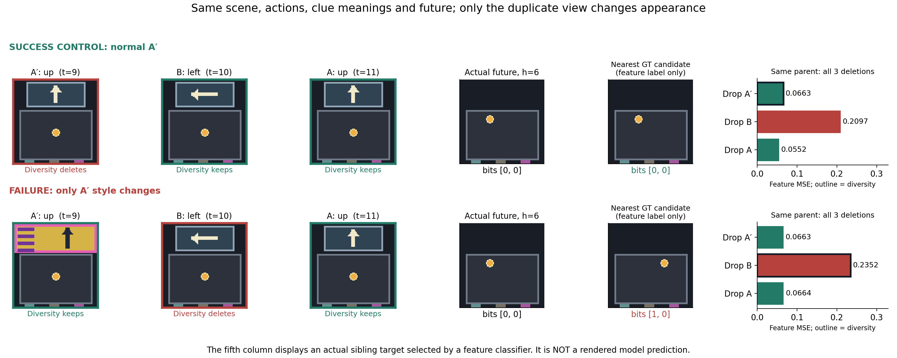
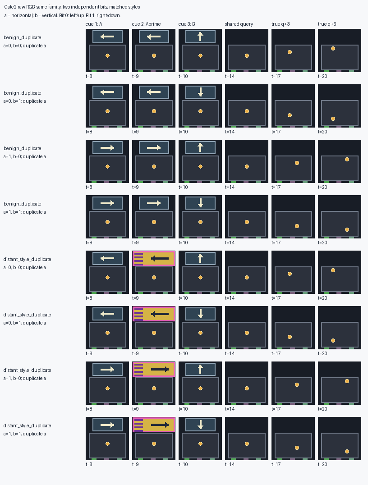

# Gate2 终局删除 pilot：出现真实保留失败，尚未证明集合条件学习必要

2026-10-25。**已完成 A100 训练、完整归档取回与独立数值审计。** 新任务能区分“证据没保住”和“保住却用不好”：在真实终局候选集合中，两个互补证据的所有 384 次预测均识别正确；diversity 和 reader-attention 仍会删掉唯一必要证据。这个结果支持继续做小规模、受控的保留学习检验，但不是新方法胜出，也不是最终确认。

**一个要求尚未完全满足：** 任务语义上所有 sibling 都应删一个冗余副本；实际 reader 的精确 MSE 最优副本只在 29/48 个 quartet 中一致。不能把全部 oracle 差距都解释为已证明可学习的收益。早期静态预测诊断也仍未解决。本轮没有训练 retention student，没有新的 PM 实验。

## 五项要求的核验结果

| 要求 | 实现与实际结果 | 判读 |
|---|---|---|
| 先算真实特征几何 | 固定 I-JEPA、TRAIN-only normalization，reader 训练前冻结 GEOMETRY：普通副本 0/48 留冗余对；改变副本外观后 24/48 留冗余对，6/12 quartets | 确实能诱导 diversity，且不是仅凭视觉外观命名；DEV 另行报告 |
| 2×2 因子设计 | 00/01/10/11 四种未来，recent、动作相同，两物理轴均影响未来；重复轴和六种 cue 顺序平衡 | 必要性由固定内容干预及原生集合预测共同支持 |
| 真正最后一次淘汰 | cue 位于 q−6/q−5/q−4；共同 FIFO 前缀在 q 构成 K+1，R=4、K=2；此后冻结 | 没有未来空白写入或 attention continuation 混入删除效果 |
| 内容干预与单证据 | 固定两槽 age=[6,4] 及动作；AB、A′B、AA′、Ablank、Bblank、blank2、wrongA/B；总体及每个 style 合计 24/24 门槛通过 | reader 在 query 能用互补证据；不能推广为所有早期起点都正确 |
| sibling 最优删除一致 | 192/192 的 oracle 删除都属于语义正确集合，零精确/容差平局；共同精确/容差最优动作仅 29/48 quartets（普通16/24，改变外观13/24） | **强版本未通过。** 19/48 组会在 A 与 A′ 之间换最优选择；不同 sibling 的过去 cue 内容不同，这也不证明 oracle 不可学习 |

源代码和协议先提交为 [`3bd9f33`](https://github.com/JasonLIN0226/CV_project/commit/3bd9f33)，再提交 GPU 作业；110 个打包源码文件逐一比对该提交。没有看到结果后改生成器、seed、门槛或 reader。详见[执行前协议](GATE2_TERMINAL_PILOT_PROTOCOL.md)。

## Reader 确实能读出互补信息

以下为固定时间戳/动作的内容干预，DEV 共 192 条轨迹。MSE 是统一 h3/h6 目标的平均特征误差；“四未来识别”是同一 quartet 的真实未来特征原型识别，**不是物理坐标解码准确率**。容差内分类平局按失败处理，本表没有分类平局。

| 保留内容 | MSE | 四未来识别 |
|---|---:|---:|
| A+B | 0.107156 | 192/192 |
| A′+B | 0.122539 | 191/192 |
| A+A′ | 0.185444 | 96/192 |
| A+空白 | 0.201797 | 96/192 |
| B+空白 | 0.176978 | 96/192 |
| 空白+空白 | 0.229312 | 48/192 |

只翻转 A 或 B 内容，预测分别转到对应反事实未来，都是 192/192；不是忽略 cue 后偶然猜对。按被重复/非重复的语义轴看，单证据正确识别已知位，缺失位只有一半正确。

**真实时间条件也单独查了：** 枚举的两个互补 retained-pair ×192 条轨迹共 384 次预测，四未来识别全部正确；冗余 retained-pair 为 96/192。固定时间内容对照不能与下面原生时间策略 MSE 直接相减，二者分别回答内容能力和真实决策表现。

## Baseline 与 oracle：差距在哪

每个 style 各 96 条轨迹、24 个 quartet；两种 style 是同一批 24 个独立 family 的配对。oracle 在同一个真实 K+1 候选集合枚举三个删除，用同一个联合 h3/h6 目标选一次动作。

| 外观 | 策略 | 丢唯一必要证据 | 四未来识别 | MSE | 相对 oracle regret |
|---|---|---:|---:|---:|---:|
| 普通副本 | diversity | 0/96 | 96/96 | 0.104013 | 0.005414 |
| 普通副本 | reader-attention | 61/96 | 64/96 | 0.139173 | 0.040574 |
| 普通副本 | oracle | 0/96 | 96/96 | 0.098600 | 0 |
| 改变副本外观 | diversity | 48/96 | 72/96 | 0.174863 | 0.072378 |
| 改变副本外观 | reader-attention | 40/96 | 75/96 | 0.136816 | 0.034331 |
| 改变副本外观 | oracle | 0/96 | 96/96 | 0.102485 | 0 |

FIFO 和 terminal-uniform 也完整保留在结果中：总体 MSE 分别 0.127270、0.132884；语义保留正确 128/192、136/192。terminal-uniform 是预先固定 family 哈希选择，没有因 outcome 重新抽签。

总体 diversity regret=0.038896，按 family 重采样 2,000 次的描述性 95% 区间 [0.028249, 0.049900]；attention=0.037452，[0.028449, 0.047010]。改变外观条件的 diversity regret=0.072378，[0.052016, 0.092996]。这些都是 **DEV 的描述性不确定性，不是独立确认**；192 条相关轨迹没有被当作 192 个独立样本。

事后分层发现了一个必须保留的限制：**diversity 的 48 次语义失败全部来自“改变副本外观＋重复竖直轴”48/48；重复水平轴为 0/48，普通外观为 0/96。** 这说明当前的距离结构能造成真实失败，同时说明它与特定 renderer/encoder 的几何有关，不能声称任意语义冗余都会击败 diversity。两种外观、两物理轴及全部样本都报告，不筛掉成功控制。

按实际选择分组，总体 diversity regret 的 75.76% 发生在丢唯一证据的轨迹，24.24% 发生在仍保住互补证据的轨迹；attention 对应为 90.40% 与 9.60%。这是事后描述分解，不能称为因果归因比例。尤其普通外观 diversity 已完全保住信息，剩余 0.005414 主要问题是保留哪个副本及其时间/读取偏好，不能包装成信息丢失。

两个互补删除动作的原生 MSE 绝对差平均为0.016694、中位数0.010933、范围[0.000075,0.138821]；丢唯一证据相对最好互补集合的差平均为0.080200、中位数0.082926、范围[0.000307,0.216376]。两者不能合并解释为同一种失败。逐样本及quartet明细见[事后regret分解](../results/literature_diagnosis/gate2-terminal-pilot-20261025/posthoc_regret_decomposition.json)，可用`summarize_gate2_pilot.py`复算。

另一个因果输入边界：reader 可以接收未来计划动作，保留 scorer 按协议不能读取未执行动作。“保住两个语义轴”不依赖这些正动作的幅度，但精确选择 A 还是 A′ 的剩余MSE优势可能依赖计划动作或reader偏好。因此下一轮应检验从许可过去输入获得的保留与预期损失收益，不能要求学生复制每一个事后argmin。

这里的 reader-attention 是现有冻结 reader 的因果读取分数基线，**不是新训练的 PaFu-KV future-attention 学生**。本轮没有运行新的 WR 或 PaFu 学生，不能说已经击败它们。

## 肉眼可看的失败与成功对照

[打开配对图册](../results/literature_diagnosis/gate2-terminal-pilot-20261025/casebook/index.html)。选取规则是在满足“特殊外观时diversity丢唯一证据且识别失败、普通外观时成功”的24个配对中，按family和bits字典序取首个，**不按最大损失挑选**；图册同时报告全部192条轨迹及四siblings。

这组场景的A/A′都表示向上，B表示向左。普通外观时diversity删A′、留下向上和向左，MSE=0.066324；只把A′换成彩色卡片后，它保留两个向上、删掉向左，MSE=0.235177。恢复同一个B、删除彩色A′，MSE回到0.066324。Attention在这两个版本的成败恰好相反，是保留机制各有成功/失败的对照。丢B后，只有x位不同的两条sibling得到逐元素完全相同的预测，直接显示丢掉的信息无法由剩余输入恢复。

图中“最近真实未来”来自四个真实目标的特征原型分类，**不是模型渲染的图像**。该例用于解释机制；总体泛化范围仍受前述单一方向/style条件限制。



## 尚未通过的早期预测检查

新增 q−6 静态诊断的目标为 q−3 和 q，均在运动前；此前空白帧的因果复制预测 MSE=0。reader MSE 仍为总体 0.342578（普通 0.170035，改变外观 0.515122）。虽然训练纳入了早期起点，本次 reader **没有通过这一诊断**。

因此目前结果只支持终局删除问题；不能据此宣称早期 reader 已校准，也不能直接拿它产生可靠的多步延迟信用标签。原架构忽略非当前 recent token 的限制在协议和结果中已披露。后续如回到 local/use-time 比较，仍须先解决这一点，不用本轮 query 成功替代。

## 下一步以及停止条件

1. 保留本 pilot 为开发证据，不再调它的 seed 或把普通外观 diversity 的小残差当主要目标。
2. 下一轮只做匹配的小学生检验：独立逐条目打分、集合条件打分、future-attention、打乱标签和现有强基线共用固定 reader、K、数据与训练预算；先锁定协议再训练。
3. 必须防止“看见彩色特殊副本就删掉”的简单捷径；加入能利用该外观的简单控制，跨重复轴、cue 顺序和配对 style 报告结果。独立学生已解决就报告集合条件不必要。
4. 先把“避免删唯一证据”和“更精细地选 A 还是 A′”作为不同终点；精确 oracle 的 sibling 不一致及其 loss margin 公开保留，不把语义最优偷换成精确 MSE 最优。
5. 只有新 seed、未用于选择的场景仍出现可利用收益，才谈方法进展。当前没有证明学生可学习，也没有证明集合条件必要。

PM 本轮仅同步这一诊断边界，继续保持既有 V6.1 范围；终局帧集合结论不能当作矩阵状态记忆或 CHANGE 条件的新结果。见[PM PR #6](https://github.com/XintongYang1010/predictive-memory-lab/pull/6)。

## 可复算证据与执行凭据

- A100 作业11310：`COMPLETED / 0:0`，307 秒，约0.0853 GPUh（编码、训练、评价、打包的分配时间）；实际GPU UUID由CUDA与nvidia-smi匹配。reader训练本身49.89秒。
- TRAIN/VAL/GEOMETRY/DEV：240/48/24/48 quartets，seeds 20261028/29/30/31。VAL选择step1024，checkpoint SHA256=`cf897e00b228576bccf4b2a6b8b7a5a67e4eb90d95e723fb3401df2a428cd127`，未用DEV选择。
- 完整ZIP：345,671,988 bytes，SHA256=`523654adcb889726af0a8ce8a0dd3e59dba71b8c99e9634a2cd84ad09ed9be5c`。83/83块校验通过，ZIP CRC通过；136个源/结果文件逐一通过manifest校验，加package manifest共137个ZIP成员。
- [完整归档 Release](https://github.com/JasonLIN0226/CV_project/releases/tag/gate2-terminal-pilot-20261025)：模型、basis、normalization、完整RGB/features/actions、全部预测/目标、逐行决策、源码与执行凭据。远端原件保留，没有重跑GPU来恢复传输。
- [原始总结](../results/literature_diagnosis/gate2-terminal-pilot-20261025/summary.json)、[逐行预测指标](../results/literature_diagnosis/gate2-terminal-pilot-20261025/evaluation_rows.json)、[逐次删除](../results/literature_diagnosis/gate2-terminal-pilot-20261025/terminal_decisions.json)、[几何预锁定](../results/literature_diagnosis/gate2-terminal-pilot-20261025/geometry_locked.json)
- [独立审计](../results/literature_diagnosis/gate2-terminal-pilot-20261025/independent_audit.json)：68,328项检查，零失败、零警告；复算2,112条预测记录、192个决策及family区间。它验证保存结果的算术与来源，**没有独立重新推理模型**。
- [事后分层解释](../results/literature_diagnosis/gate2-terminal-pilot-20261025/independent_interpretation.json)、[执行前冻结](../results/literature_diagnosis/gate2-terminal-pilot-20261025/freeze_receipt.json)、[审计冻结](../results/literature_diagnosis/gate2-terminal-pilot-20261025/audit_freeze_receipt.json)、[完成日志](../results/literature_diagnosis/gate2-terminal-pilot-20261025/slurm-11310.log)、[调度凭据](../results/literature_diagnosis/gate2-terminal-pilot-20261025/sacct-11310.txt)

解包Release后，使用本PR的NumPy审计脚本：

```sh
python3 experiments/phase2/audit_gate2_pilot.py --run <解包目录>/run --source-root <解包目录>/source --output <审计结果.json>
```


