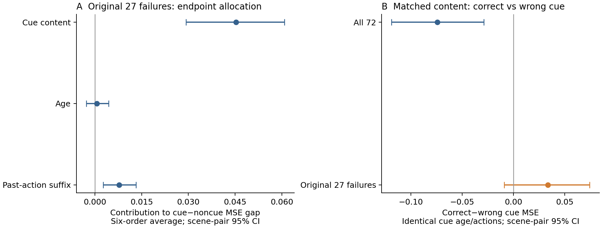

# Gate cue 内容、年龄和动作的组合诊断（2026-10-22）

**这次把关键混淆拆开了：在原来的 27 个局部失败案例中，即使单独交换 cue 内容并固定时间与动作，预测仍可能变差。固定原始 cue 时间和动作后，21/27 个失败案例使用正确 cue 的误差高于同场景的错误 cue。** 同时，在全部 72 个可比较案例中，48 个正确 cue 更好，24 个更差；这不是整个预测器统一把标签学反了。

本次仅诊断已有 192 个 development episode 中可比较的 72 个（36 个 scene pair）。其余 120 个实际父集合保留了两份等价 cue，一次删除无法完全移除 cue，未混入此对照。没有训练、改变预测器、修改原保留集合，或使用新的未观察场景来选参数。

## 预先固定的比较

对每个原来的实际 attention K+1 父集合，找到原始 best-with-cue 和 best-without-cue 两个 K=2 子集。二者共享同一个 filler，只替换另一槽。共享 filler、四帧 recent context、query、未来 controls 和模型权重始终保持不变。

| 因素 | 0 | 1 |
|---|---|---|
| 内容 C | 被交换的 noncue 帧 | 原来的正确 cue 帧 |
| 年龄 T | noncue 的原始时间位置 | cue 的原始时间位置 |
| 动作 A | 从 noncue 时间到 query 的已执行动作和 | 从 cue 时间到 query 的已执行动作和 |

执行全部 `2×2×2` 组合：`000` 恢复原来的 noncue 子集，`111` 恢复原来的 cue 子集。另加四组 sibling 错误 cue 内容，分别匹配所有 `(T,A)` 组合，合计每个 episode 12 条预测、全量 **864 条预测**。两个 horizon 始终共用一次相同的历史决策，主指标为 `0.5*(MSE_h3+MSE_h6)`。

内容/年龄/动作的混合输入可能是物理上不一致的历史，也可能超出训练分布；它们测的是**固定模型对输入路径的反应**，不是部署策略、真实世界因果效应或修复后的性能。错误 cue 是 evaluator 提供的匹配内容干预。端点子集仍由原始未来损失在其 cue 类别中选择，不能因此把它们称为因果策略。

[协议](../results/literature_diagnosis/cue-factors-20261022/protocol.json)在结果产生前写入，含全部组合、聚类置信区间和代表案例选择规则。

## 内容、年龄和动作各贡献多少

为避免随意指定“先改哪一个因素”，这里对改变 C/T/A 的六种顺序求平均，得到三个端点差距分配值（Shapley allocation）。它们逐样本精确相加为 `L111−L000`；交互效应按该约定分摊。它不是物理原因百分比。

| 因素 | 全部 72 个案例：平均端点分配 | 原始 27 个失败案例：平均端点分配及 95% CI |
|---|---:|---:|
| Cue 内容 | −0.008454 | +0.045316 [0.029288, 0.060813] |
| 年龄 | −0.000703 | +0.000615 [−0.002797, 0.004371] |
| 已执行动作摘要 | +0.004784 | +0.007793 [0.002691, 0.013213] |
| **合计 cue−noncue 误差** | **−0.004373** | **+0.053724** |

所有均值和置信区间均先在 scene 内平均，再对 scene pair 等权；全量为 36 个 scene，失败子集为 18 个 scene / 27 个 episode。该失败子集按原来的端点损失定义，区间仅描述这批已观察的条件子集，不是独立新场景的确认性结果。

原始失败子集中，内容项明显大于单独的年龄项，动作摘要也有可见作用。三阶内容×年龄×动作差分为 **+0.006798**，95% CI `[0.002669, 0.011119]`；因此不能把三个因素理解成彼此独立的加法原因。全部平衡主效应、二阶/三阶交互和每个 episode 的分解均保存在 [factor_effects.json](../results/literature_diagnosis/cue-factors-20261022/factor_effects.json)。

读路径的检查也一致：对于固定内容，改变年龄/动作不会改变这个模型的 content-only attention。所有 **216 组**检查逐值一致；年龄和动作会经由时间统计、aligned memory、velocity 和 transport 路径改变预测。完整路径数值和派生效应已保存在结果中，未关掉任何模型路径。

## 固定年龄和动作后，正确 cue 是否指向正确未来

下面只改变内容：正确 cue 与 sibling 错误 cue 使用完全相同的原始 cue 年龄、动作摘要和 filler。

| 范围 | 正确 cue 更好 | 正确 cue 更差 | 正确−错误 cue 的平均 MSE 差值，95% CI |
|---|---:|---:|---:|
| 全部 72 个 | 48 | 24 | −0.074202 [−0.118760, −0.028984] |
| 原始 27 个失败 | 6 | 21 | +0.033571 [−0.009006, +0.074239] |

误差方向计数与配对未来方向的变化计数相同：在 21 个失败案例中，正确 cue 也让预测沿正确 sibling 方向的平均分量低于错误 cue。失败子集的均值区间仍跨零，所以不声称在整个失败分布上存在已确认的统一反转。

在另外三个完全匹配的年龄/动作组合上也执行了相同检查，而非只挑出有利组合。全部 72 个案例的正确−错误 cue 平均 MSE 差值分别为 `−0.081242`、`−0.070976`、`−0.084815`，三个 scene-pair 区间均低于零；逐项结果见 [correct_minus_wrong.json](../results/literature_diagnosis/cue-factors-20261022/correct_minus_wrong.json)。



## 三个按预先规则选出的可视化案例

以下案例用于解释机制，不代替全量发生率与分布。完整 12 条组合和 reader 数值见 [case_cards.json](../results/literature_diagnosis/cue-factors-20261022/case_cards.json)。

| 案例 | Episode ID | cue / noncue / filler / query | 未来帧 |
|---|---|---|---|
| 内容伤害最大 | `bdf81bd672d2a45fbbd832d0` | 4 / 13 / 14 / 18 | 21、24 |
| 年龄贡献最大 | `cc08d03c90c3991d601a7642` | 7 / 11 / 12 / 16 | 19、22 |
| 正确 cue 成功对照 | `43e7360f65e191be05005554` | 3 / 31 / 32 / 36 | 39、42 |

**内容失败案例**：原 noncue 子集 MSE 为 `0.127822`。只把槽内内容换成正确 cue、保留 noncue 的时间和动作，MSE 变成 `0.324210`，所以这个变化不能由年龄/动作差异解释。实际 cue 端点 MSE 为 `0.272983`；在完全相同的 cue 时间和动作下换成错误 cue，反而得到 `0.107229`。正确 cue 的 attention 为 `0.999771`，两个 horizon 的配对未来振幅为 `−0.6887、−0.6083`；错误 cue 为 `+0.0825、+0.2197`。模型并没有漏读这条线索，但内容和最终未来方向之间的映射在此失败。

**年龄参与的案例**：原 noncue MSE 为 `0.103434`，实际 cue 为 `0.235845`。其端点分配为内容 `+0.108807`、年龄 `+0.036611`、动作 `−0.013007`。这说明年龄可以显著放大某些具体案例的错误，尽管它在 27 个失败案例的平均作用较小。

**成功对照**：在更长间隔下，原 noncue MSE 为 `0.120658`，实际正确 cue 为 `0.082113`。同样的 cue 时间和动作搭配错误 cue，MSE 升到 `0.597378`；正确 cue 的未来振幅为 `+0.3523、+0.9425`。这证明同一个冻结模型在另一些场景中确实能按正确方向利用线索。

## 对 proposal 的意义

此前已经确认：cue 可由受支持的训练方向解码，屏蔽低训练支持的输入坐标也没有消除大部分 cue penalty。现在进一步确认，部分错误在内容匹配干预中仍然存在，不能全部归因于 oracle 选择了有利的历史时间。

这要求区分“没有保存证据”和“共同预测器错误使用已经保存的证据”。在内容失败案例中，线索被保留且获得很高 attention，预测却更偏向错误未来。此时删除正确 cue 可以降低当前模型的损失，但这还不能支持“任务本来不需要该线索”，也不能直接成为新 memory scorer 的论文收益。

下一步应在事先固定的新场景上检验这两个方向：这种条件性的 reader 内容失败是否重复出现，以及在共同预测器能够正确使用 cue 的场景里，保留策略相对局部 oracle 是否仍有稳定缺口。本报告本身没有运行或宣称完成这项新场景验证。

## 验证和复现

- CPU，仓库 `.venv`，Torch/BLAS 1 线程；主运行 4.62 秒。
- 144 条原始端点预测与上一轮保存向量逐值一致，预测器权重和来源哈希保持不变。
- 导出器独立用六种排列重算全部 432 个 `episode×metric` 的端点分配，并从 864 条保存向量重算四种误差。没有新增模型调用。
- 3 个定向测试覆盖组合分解、内容/时间/动作隔离以及交换槽跨 filler 顺序的情况。
- [源码](../experiments/phase2/diagnose_gate_cue_factors.py)、[摘要](../results/literature_diagnosis/cue-factors-20261022/summary.json)、[独立审计](../results/literature_diagnosis/cue-factors-20261022/independent_audit.json)、[哈希清单](../results/literature_diagnosis/cue-factors-20261022/manifest.json)。大预测向量留在忽略的 build 目录，发布清单记录其 SHA256 和大小。

```bash
OPENBLAS_NUM_THREADS=1 OMP_NUM_THREADS=1 VECLIB_MAXIMUM_THREADS=1 \
  .venv/bin/python experiments/phase2/diagnose_gate_cue_factors.py \
  --output build/literature-diagnosis-20261022/cue-factors-replay
```
