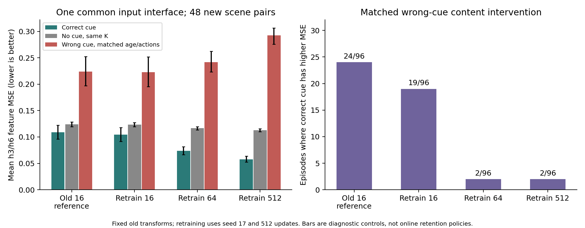

# 延迟删除信用：2026-10-24 可行性试验

这轮把“标签是否错了”“reader 能否使用证据”“学生能否学到保留收益”分开检验。已完成原训练数据的标签审计、固定 continuation 的 use-time 标签与学生试验，以及 A100 上的 16/64/512 对 reader 比较。扩样后的学生试验结果另行追加，不能用 oracle 的结果替代它。

## 目前已经检验的三个层次

| 层次 | 实际结果 | 可以说什么 |
|---|---|---|
| 原短期标签 | 130 个使用前、最后一份 cue 处于删除风险的 TRAIN parent 中，111 个 local-cost 最优动作删 cue | 早丢并不全是学生拟合失败，标签确实会奖励丢证据 |
| 改在使用时刻评价 | 同一批 parent 统一 attention 续跑，use-time 的最优集合没有一个包含删 cue 的动作 | 指定 continuation 下的反事实排序得到修正；尚非在线泛化收益 |
| 原 16 对训练的学生 | use-time 在训练 32/32 保 cue，但已查看开发集仅 74/192，MSE 0.125385；attention 192/192、0.110337 | 这个固定 ridge 配置没有泛化成功，不能宣布方法成立 |
| A100 reader 扩样 | 新 48 对场景上，16/64/512 对训练的 cue MSE 为 0.104284 / 0.073858 / 0.057564 | 同一架构与特征变换下，训练覆盖明显影响证据利用能力 |

标签审计见 [GATE_USE_TIME_LABEL_AUDIT.md](GATE_USE_TIME_LABEL_AUDIT.md)，完整原学生结果和实际标签定义见 [GATE_USE_TIME_PROBE.md](GATE_USE_TIME_PROBE.md)。A100 的训练、选择与评价协议、剩余错误和数据文件见 [GATE_READER_SCALE_PROBE.md](GATE_READER_SCALE_PROBE.md)。

## A100 上确认了什么

作业 **11026** 在 **NVIDIA A100-SXM4-40GB** 上执行，Slurm 最终状态 `COMPLETED`、退出码 `0:0`，单 GPU 分配时间 **539 秒**。Torch 设备 UUID 与 `nvidia-smi` 一致。编码 8,640 张去重图像后，三个 reader 各训练 512 次更新。

在同一批 96 条 episode / 48 对新场景中：

| Reader 训练场景对 | 保正确 cue 的 MSE | 正确 cue 比匹配的错误 cue 更差 | 至少一个 horizon 的特征方向错误 |
|---|---:|---:|---:|
| 16 | 0.104284 | 19/96 | 33/96 |
| 64 | 0.073858 | 2/96 | 10/96 |
| 512 | 0.057564 | 2/96 | 4/96 |

512 对 reader 的剩余两条“正确 cue 更差”来自同一对场景，不能当成两个独立发现。这里的方向是 sibling future feature 对比轴上的符号，不是解码后小球轨道准确率。旧图册中的具体 case 没有逐一重放，不能说每个旧 case 都已被修复。

独立 NumPy 审计直接使用下载的 1,920 条保存预测和 96 条目标，重算逐条误差与 80 个汇总值，全部通过；最大 MSE 算术差异为 1.11e−16。该检查验证数值与文件绑定，不替代任务语义验证。三模型同初始化、同最大更新预算，但 validation 选择的步骤分别为 128/448/448；只有一个训练 seed。因此它是固定训练与选择流程下的覆盖比较，不能把全部改善严格归因于单独的数据量变量。

## 为什么不能直接宣称发现了新的延迟信用方法

原开发 reader 只在 `query` 时刻训练，local-cost 却在每个 overflow 时刻调用它。use-time 同时把目标移到证据发挥作用之后，也把 reader 的评价起点移回训练分布。这两种变化没有被本轮隔离。即使 use-time 学生后来改善，也还需要一个多起点训练的 reader 对照，判断收益是否只是修正了 teacher 的使用分布。

“延迟的任务反馈学习保留什么”已有先例：[LEMN](https://arxiv.org/html/1812.04227) 使用后续问答奖励学习有界记忆替换；[KVP](https://arxiv.org/html/2602.10238) 以未来 attention 构造强化学习奖励；[TVT](https://arxiv.org/html/1810.06721) 把后期关联到记忆的价值传回较早动作。这些工作与逐条目反事实删除目标不完全相同，但足以排除“延迟信用本身是新意”的说法。本轮也没有比较估计方差，不能把“反事实所以低方差”写成结果。

补查原文后，还有更直接的先例，建议先读前两篇：

| 论文与版本 | 与本试验的重叠及区别 |
|---|---|
| [VitaBench / VitaMem，2026-10-10 v1，§5、附录D](https://arxiv.org/html/2610.14731v1#S5) | 已用同状态动作分支、相同未来流及 continuation 生成长时距标签，再训练只看过去的学生，并讨论后续策略的影响。其生命周期动作和指定算子效用不同于固定K帧的视觉预测损失，但高层方案已重叠。 |
| [MGPO，2026-09-29 v1，§2](https://arxiv.org/html/2609.37930v1#S2) | 以文本记忆改写前后对当前及未来任务的增量效用训练writer；不是逐帧K+1删除后继续淘汰，但已覆盖延迟的反事实记忆信用。 |
| [OSL-MR，2026-06-29 v6，§3](https://arxiv.org/html/2606.10616v6#S3) | 已研究预算、延迟成本和离线证据监督／在线可观察输入隔离；其证据成员标签与可付费重新获取不同于本试验。 |

因此，**作为课程 proposal 内的受控适配可以继续，作为独立新方法的创新性尚未成立**。固定K或改成视觉任务本身不构成创新证明；后续必须具体说明哪个未解决的失败仍存在、为什么已有方法不能解决。上述差异只是待检验的研究线索。

## 下一步的判断标准

先在一个确实会利用 cue 的冻结 reader 上，比较同结构、同容量的 local-cost、use-time、future-attention 学生和打乱标签，以及 attention/diversity。需要同时看 cue 存活、逐场景误差和对强基线的差距；只改善训练标签排名不够。

若只能修复早丢，仍可作为 proposal 中监督目标的受控消融。只有在强基线也遇到稳定、可由过去区分的失败，并且价值监督学生在新 seed 上获得收益，才值得进入方法主线。诱饵任务需要让过去信息足以判别真线索，不能依靠隐藏随机角色制造不可学习的 oracle 优势；也不能预先保证 attention 或 diversity 必然失败。

本轮没有实现 TD。条目间的互补、未来替换策略和终止条件尚未写成完整状态与目标，直接使用“当步代价 + γ × 下一步存活价值”可能把不同反事实混在一起或重复计分。PM 仓库只更新证据连接，不把本次 CV feature MSE 当作 PM 的新实验结果。

## 运行中断记录

A100 job 11026 已正常完成并下载核验；后续 CPU 扩样测试所用交互会话 11023 被调度器标为 `CANCELLED by 0`，分配 2112 秒，原时间限制 1 小时。账目没有给出进一步原因，不把它解释为超时或内存耗尽。中断日志与部分输出保留。恢复脚本只重启尚未完成的 CPU 部分，不重做 A100 训练，也不改变实验标签、拟合参数或评价数据。
