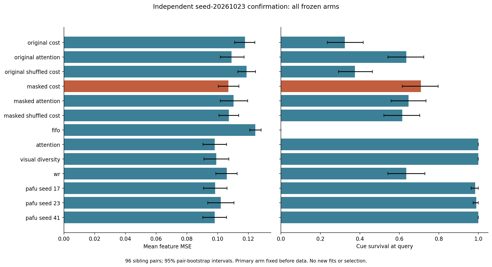

# Gate 独立新场景确认：没有建立任务损失 probe 的保留收益

**主要判据未通过。** 原先冻结的 masked cost ridge 在新96对场景上没有可靠胜过打乱标签
对照，而且 MSE 明确高于 reader-attention 和 diversity。不能将这批结果用来宣布新的
memory 方法成立，也不能从其他 arm 中挑选较好的结果替代原判断。

本轮使用 seed20261023 的 ID / long gap / distractor shift 各32对，共192条轨迹。
新场景与所有旧元数据、上一轮96对的 seed/ID/pair 无重叠。原始与 masked 的三个
probe、WR、PaFu、强对照、归一化、表示和 epoch-35 reader 均冻结；没有重训、调参、
支持域选择或更换预测器。此前数据全部作为开发数据，此轮是同一生成器家族的独立种子
确认，并非跨任务泛化或原 Phase 1 正式测试集。

## 协议确实先于生成与结果

机器协议的 SHA256 为
`977feb00d44ce388157e05aaa1ec0f28f1960f182b4e46068618571c2615c734`。
独立时间审计确认 UTC 顺序：

| 事件 | 时间 |
|---|---|
| 冻结协议与源码/参数 | 2026-10-23 03:14:30.795334 |
| 提交 Slurm 10167 | 2026-10-23 03:20:07.887092 |
| 开始编码 | 2026-10-23 03:21:54.250296 |
| 结束编码 | 2026-10-23 03:23:45.200204 |

实际设备为 NVIDIA A100-SXM4-40GB，GPU UUID 记录在 manifest，Slurm 分配时长123秒。
本地 CPU 策略/局部 oracle 评价用时54.93秒，零拟合。编码执行和导出/审计是不同步骤，
提交回执中的历史状态没有被改写成完成状态。

依据：[冻结协议](../results/literature_confirmation/gate-seed20261023/locked_protocol.json)、
[时间审计](../results/literature_confirmation/gate-seed20261023/evaluation-v1/temporal_audit.json)、
[实际执行归档](../results/literature_confirmation/gate-seed20261023/execution/execution_receipt.json)。

## 预先指定的三个主要差异

统一目标为一次删除的 `L=(MSE_h3+MSE_h6)/2`，R=4、K=2。表中差值均为
**masked cost 减去对照**，负数才有利于 cost。以96个 sibling 配对为独立单位，
先平均 episode，再平均两条 sibling，固定5,000次 bootstrap。

| 对照 | 在线 MSE 差 | 配对95% CI |
|---|---:|---:|
| 同容量 masked shuffled-cost | −0.000273 | [−0.003626, +0.003581] |
| Reader-attention | +0.008909 | [+0.004461, +0.013363] |
| Diversity | +0.007823 | [+0.002915, +0.012922] |

冻结规则要求三个区间上界**全部小于0**；实际没有通过。它是三个要求的合取判断，
不能用某个单独条件、其他 seed 或次要指标替代。原始文件见
[primary_decision.json](../results/literature_confirmation/gate-seed20261023/evaluation-v1/primary_decision.json)。

## 全部13个 arm 的在线结果

| 冻结策略 | 平均 MSE | Cue 存活率 | 未来分支方向误差 | 分支正确率 |
|---|---:|---:|---:|---:|
| 原始 cost ridge | 0.117792 | 32.29% | 0.064957 | 61.98% |
| 原始 attention ridge | 0.109047 | 63.54% | 0.053224 | 71.09% |
| 原始 shuffled-cost ridge | 0.118941 | 37.50% | 0.065147 | 61.20% |
| **Masked cost ridge（主要 arm）** | **0.107057** | **70.83%** | **0.050488** | **72.40%** |
| Masked attention ridge | 0.110362 | 64.58% | 0.054113 | 70.05% |
| Masked shuffled-cost ridge | 0.107330 | 61.46% | 0.051753 | 71.61% |
| FIFO | 0.124575 | 0% | 0.077792 | 50.00% |
| Reader-attention | 0.098148 | 100% | 0.039865 | 82.03% |
| Diversity | 0.099234 | 100% | 0.041513 | 80.73% |
| 原 WR | 0.106003 | 63.54% | 0.052623 | 70.83% |
| PaFu seed17 | 0.098500 | 98.44% | 0.040637 | 81.77% |
| PaFu seed23 | 0.102036 | 98.96% | 0.042031 | 80.99% |
| PaFu seed41 | 0.098113 | 100% | 0.039996 | 81.51% |

所有 arm 完整保留，没有选择 PaFu 的最好 seed 作为主要对照。WR 保持原启动逻辑；
之前的因果前缀是单独诊断，未混入本轮比较。Mask 仅复用旧 TRAIN RMS≤1e-6 的710列
系数置零规则，不根据新数据增加或移除列。

## 任务方向和证据链也没有支持一个被 MSE 掩盖的胜利

Masked cost 相比 reader-attention，多出的 **0.010623** 误差位于两个 sibling 未来的
分支差异方向，95% CI `[0.005854, 0.015513]`；正交误差反而降低0.001714。
它的分支正确率低9.64个百分点，CI `[−13.80, −5.73]`。相比 diversity，分支方向
误差高0.008975，CI `[0.003702, 0.014531]`，分支正确率低8.33个百分点。
因此在这个评估分解下，较高总误差并非仅来自无关方向；正交余项也不能被默认视为无关信息。

相比 masked shuffled-cost，cost 的 cue 存活率高 **9.375个百分点**，CI
`[4.167, 15.625]`，但分支正确率只高0.781个百分点，CI `[−2.083, 3.646]`；
分支方向误差差为−0.001265，CI `[−0.004868, 0.002405]`。这项次要观察说明其保留
行为存在差异，**不能把更高的 cue 存活率直接换成已证实的任务收益**。

Masked cost 在192条轨迹中有56条完全丢失 cue 信息，第一次完整丢失时间中位数t=8
（范围6–13）；attention/diversity 都没有发生该丢失。按条件，cost 的存活率为
ID 39/64、long gap 33/64、shift 64/64。它在 long gap 相对 attention 多0.016932 MSE，
CI `[0.008465, 0.025456]`；在 shift 虽保住全部 cue，相对 attention 的 MSE 差
−0.000707，CI `[−0.003539, 0.001708]`，仍不能选这个条件宣布成功。

这些任务检查是预先指定的描述性分析，未做多重检验校正。分支方向使用未来真值构造，
只存在于 evaluator；它不是物理状态 readout 或规划成功率，也未进入 online 输入。
完整差值见 [task_contrast_comparisons.json](../results/literature_confirmation/gate-seed20261023/evaluation-v1/task_contrast_comparisons.json)。

## 同一个候选集合上的局部决策仍然较弱

共同集合取实际 FIFO/diversity/attention 的最终 K+1 状态并去重，共511个 parent。
该集合不由 probe 的输出挑选。每个 parent 的三个删除动作共享同一个多 horizon 目标；
先平均同 episode 的 parent 再按 sibling 配对，避免把重复 parent 当独立样本。

| 策略 | 同 parent 平均 regret | 最优删除命中率 |
|---|---:|---:|
| Masked cost | 0.009216 | 36.98% |
| Masked shuffled-cost | 0.009764 | 33.42% |
| Masked attention ridge | 0.010166 | 36.81% |
| Reader-attention | 0.006414 | 41.32% |
| Diversity | 0.006832 | 36.81% |
| FIFO | 0.017013 | 26.82% |

Cost−null 的同 parent 差为−0.000548，CI `[−0.001830, 0.000825]`；cost−attention
为+0.002802，CI `[0.001140, 0.004516]`；cost−diversity 为+0.002384，CI
`[0.000580, 0.004256]`。方向与完整在线结果一致，不是仅由不同策略到达了不同
parent 造成的。WR 的 controller 依赖路径，未伪造共同 tracker 来参与此表。

这些是局部 query oracle；本轮没有重新枚举完整历史档案。仍存在 oracle gap，不等于
这个 gap 已被 cost probe 学到，或可以由任何有界因果策略完全恢复。

## 可复核范围和下一步边界

完整输出保留2496行在线结果、511个共同 parent、每个局部候选损失及全体配对区间。
独立 exporter 检查2496个保存预测的 MSE/分支分解（最大差1.11×10⁻¹⁶）、3066个冻结
probe 的共同 parent 选择、60,710个不可恢复轨迹事件、全部首次信息丢失/存活记录，
并复算所有配对 CI（差0）。**这不是独立 reader 推理重跑**；是保存向量算术、固定
probe、缓存一致性与轨迹审计，范围明确记录在 [audit.json](../results/literature_confirmation/gate-seed20261023/evaluation-v1/audit.json)。

每个 ridge 的参数/尺度数值存储仍为14,456字节；masked cost 最大动态逻辑状态
123,619字节，平均每轨迹在线处理约20.44ms；reader-attention 为123,619字节、14.90ms，
diversity 为123,626字节、5.76ms。时间是本地 CPU 描述测量，不能视为部署 benchmark；
共享 predictor/encoder 权重和 Python 分配器等未计入这些增量状态数值。同K并不等于
相同总内存与计算成本。

本轮停止于这个冻结判断，不用确认集继续调模型或更换 arm。负结果限制的是当前
16对旧训练、这组特征/容量/标签及冻结 reader 的组合，**不是 oracle 不可学习的证明**。
按 proposal，下一步应结合独立的 cue 内容/时间/动作诊断，决定是否需要重新定义训练
目标或改进共同预测器；若开发改变，所有强对照同 reader 重跑，并另留新的确认数据。
当前新场景不支持将这个 ridge probe 升级为正式方法，也不支持继续用 FIFO 的弱表现
替代强 baseline 的比较。

[完整结果归档](../results/literature_confirmation/gate-seed20261023/evaluation-v1/README.md) ·
[预先冻结的中文协议](GATE_CONFIRMATION_PROTOCOL.md) ·
[运行器](../experiments/phase2/run_gate_confirmation.py) ·
[独立导出器](../experiments/phase2/export_gate_confirmation.py)
