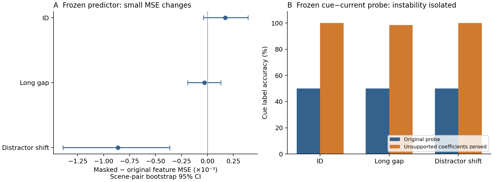

# Gate 训练输入支持范围诊断（2026-10-22）

**结论：训练覆盖不足确实导致了 cue 读出器的数值失稳，但本次统一屏蔽几乎没有消除冻结预测器的 cue penalty。不能再依据原始读出器约 50% 的准确率，说编码器没有保存线索。**

本次是对已反复查看的 development 数据进行固定诊断，不是新测试集结论，也没有产生新的保留方法、重新训练预测器或改写原 baseline。

## 固定协议

- 只用旧 Gate 32 个 TRAIN episode 的 `z[:query+1]` 计算投影统计。沿用 `diagnose_training_objective.inactive_columns` 的既有判据：`mean(projected**2, axis=0) < 1e-4`。这是**二阶矩/均方能量**阈值，不是标准差阈值；不扫描阈值。
- 在当前 unit-column、epoch-35 冻结预测器输入处，将这些坐标的 `projected_z` 和 `projected_current` 置零。原始 `current` 输出 skip、动作、时间、预测器权重和输出空间全部保持不变。
- 全量评估 192 个实际 attention 最终 K=2 集合、192 组原始 global best-with-cue / best-without-cue 集合，以及 72 组可比较的实际 attention 局部父集合。原集合在两个输入条件下保持不变；不重新选择 history，不重新运行 admission。
- 重建上一轮保存的两个训练集 cue ridge probe（cue、cue−current），先逐项验证原始分数，再仅将同一批坐标的系数行置零。均值、标准差、其他系数保持不变，没有重新拟合干预后的 probe。
- 两个 horizon 始终使用同一历史集合，损失为 `0.5*(MSE_h3+MSE_h6)`。置信区间按 scene pair 聚类，固定 5,000 次 bootstrap，seed=20261022。

协议在运行前写入，[完整结果和输入哈希](../results/literature_diagnosis/input-support-20261022/protocol.json)已保存。此次输入干预也可能偏离训练分布，**只能用于定位问题，不算修复后的模型性能**。

## 训练覆盖和秩

32 个旧训练 episode 的 query 前缀共有 **618 帧，但只有 48 个不同的归一化视觉向量**。这些前缀在精确中心化下的秩上界是 47；按输入来源的 float32 精度计算，实际投影数值秩也是 47。以 float64 容差计算得到 48，不能把舍入/中心化误差解释成新的语义维度。

128 个投影坐标中，**81 个坐标（0-based 47–127）**低于既有训练能量阈值。这些坐标仅占训练投影总能量的 `3.65e-12`。新数据 query 前缀落入这些坐标的能量比例，按 scene pair 平均为 ID **0.986%**、long gap **1.277%**、distractor shift **7.822%**。这些是描述性输入支持指标，不证明相应坐标没有语义价值。

## 冻结预测器：cue penalty 基本保留

实际 attention 保留集合的误差如下。每个条件为 64 episode / 32 scene pair；差值为屏蔽后减原始值。

| 条件 | 原始 MSE | 屏蔽后 MSE | 差值和 scene-pair 95% CI |
|---|---:|---:|---:|
| ID | 0.110059 | 0.110230 | +0.000171 [−0.000039, +0.000391] |
| Long gap | 0.098540 | 0.098512 | −0.000029 [−0.000190, +0.000130] |
| Distractor shift | 0.121591 | 0.120729 | −0.000862 [−0.001393, −0.000365] |
| 全部 192 | 0.110064 | 0.109824 | −0.000240 [−0.000465, −0.000042] |

在原来“保留 cue 更差”的固定样本集合中：

| 对照范围 | 原始异常数 | 本次消除异常 | 固定异常样本的原始 cue penalty | 屏蔽后 cue penalty |
|---|---:|---:|---:|---:|
| Global hindsight K=2 | 46/192 | 1/46 | 0.054760 | 0.055063 |
| 同一实际 attention 局部父集合 | 27/72 | 0/27 | 0.060659 | 0.060758 |

最后两列是**episode 等权描述均值**，方便与之前的 46/27 个异常分析对照。异常子集中每个 scene 可能只有一个或两个 sibling；机器报告的 bootstrap 则先对每个 scene 的现有样本求均值，再对 scene 等权。对应 global scene 等权均值为 `0.051158 → 0.051516`，local 为 `0.053724 → 0.053855`，不能混用两种均值。

全部 global cue-harm 数目从 46 降到 45；local 仍为 27。唯一 global 翻转是 `5cead56d92ac9e53ef70ba28`，cue penalty 从 `0.000714681` 变为 `−0.000075967`，属于接近零的比较。

因此，低支持投影维度确实造成小幅误差变化，尤其在 distractor shift 条件；**它们不是这批大 cue penalty 的主要可归因来源**。本次没有重新计算屏蔽后的最优 oracle，因此这些数值只比较同一批原始集合。

## Cue probe：原失败主要是数值支持问题

先前 probe 对每个坐标使用训练标准差归一化。训练中近乎不变化的坐标，在新场景上产生很大标准化值；原始分数最大达到约 `2.45e5`。将这些坐标的已有系数清零后，所有原有训练、验证和新样本仍使用同一套剩余系数，准确率如下。

| Probe / 输入干预 | 旧 TRAIN | 旧 validation | ID | Long gap | Distractor shift |
|---|---:|---:|---:|---:|---:|
| Cue 原始 | 100% | 62.5% | 48.44% | 45.31% | 50.00% |
| Cue 系数屏蔽 | 100% | 100% | 100% | 100% | 96.875% |
| Cue−current 原始 | 100% | 37.5% | 50% | 50% | 50% |
| Cue−current 系数屏蔽 | 100% | 100% | 100% | 98.4375% | 100% |

屏蔽后 cue−current probe 在三个新条件上的最大绝对分数分别为 **1.009、0.999、1.023**。图中展示该 probe 与预测器输入干预的不同结果。



这个 probe 由 evaluator 提供真实 cue 位置，且训练标签仅用于诊断读出器，**不是可部署的记忆选择策略**。它说明这些缓存视觉特征中的线索可以由旧训练标签学到的受支持线性方向解码，不能证明冻结 world model 已经正确使用它，也不能直接证明最优删除动作可以因果地学到。

## 对当前研究结论的影响

1. 撤回“原 cue probe 接近机会水平，因此视觉编码可能没有线索”的解释。原 probe 失稳，修正这个诊断机制后线索几乎完全可读。
2. 也不能把大 cue penalty 简单解释成这个输入支持问题。相同支持屏蔽对冻结 world model 的影响很小，局部 27 个异常全部保留；reader 如何把可读线索映射到未来预测仍需检查。
3. 保留原 proposal 的顺序：先确认共同预测器能稳定利用任务相关线索，区分局部 oracle 和可利用的过去信息，再谈训练自己的保留 scorer。既有 global oracle 的时间选择可携带事后未来信息，其优势不能直接视为可学习上限。
4. 这组结果不构成性能提升宣告或新方法；所有比较仍是重复使用的 development 数据，需要另设训练/验证覆盖与未观察配对场景后才能做确认性检验。

## 复核与复现

- 正确运行使用仓库 `.venv/bin/python`：NumPy 1.26.4 / OpenBLAS、Torch 2.14.1；1 个 Torch/BLAS 线程，7.51 秒 CPU。没有新增编码或 GPU 任务。
- 1,440 条预测记录；720 次原始集合损失重放通过；其中 528 条 global/local 原始预测与前次保存向量逐值一致，192 条 attention 原集合和损失核对通过。
- 464 条前次 cue probe 分数完全一致。冻结模型状态哈希不变。导出器对全部 1,440 条保存预测重新计算 feature / raw / contrast / orthogonal 指标，没有新增模型调用。
- 首次尝试误用了系统 Python（NumPy 2.0.2 / Accelerate、Torch 2.8.0），第一条原始损失与保存值相差约 `1.26e-8`，严格重放断言立即停止；没有查看该尝试的 mask 结果。已保留[失败记录](../results/literature_diagnosis/input-support-20261022/failed-first-runtime/failure_receipt.json)。换用原环境后原断言通过，没有调整阈值、策略、模型或数值容差。
- 3 个定向测试通过；[源代码](../experiments/phase2/diagnose_gate_input_support.py)、[完整摘要](../results/literature_diagnosis/input-support-20261022/summary.json)、[独立复核](../results/literature_diagnosis/input-support-20261022/independent_audit.json)、[文件清单](../results/literature_diagnosis/input-support-20261022/manifest.json)均已保存。

```bash
OPENBLAS_NUM_THREADS=1 OMP_NUM_THREADS=1 VECLIB_MAXIMUM_THREADS=1 \
  .venv/bin/python experiments/phase2/diagnose_gate_input_support.py \
  --output build/literature-diagnosis-20261022/input-support-replay
```

运行需已有的已校验旧训练缓存、fresh 缓存、metric-reader-v2 和 reader-local-v2 结果；源码默认路径已明确绑定。约 53 MiB 的全部预测向量留在忽略的 build 目录，哈希和大小列在公开 manifest 中，不上传大型二进制。
