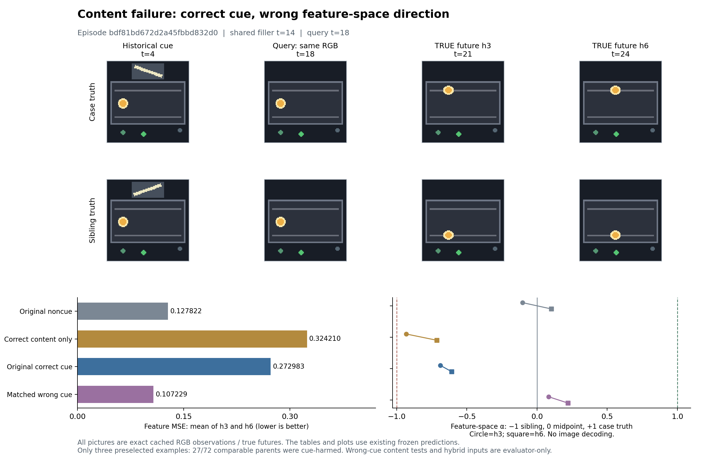
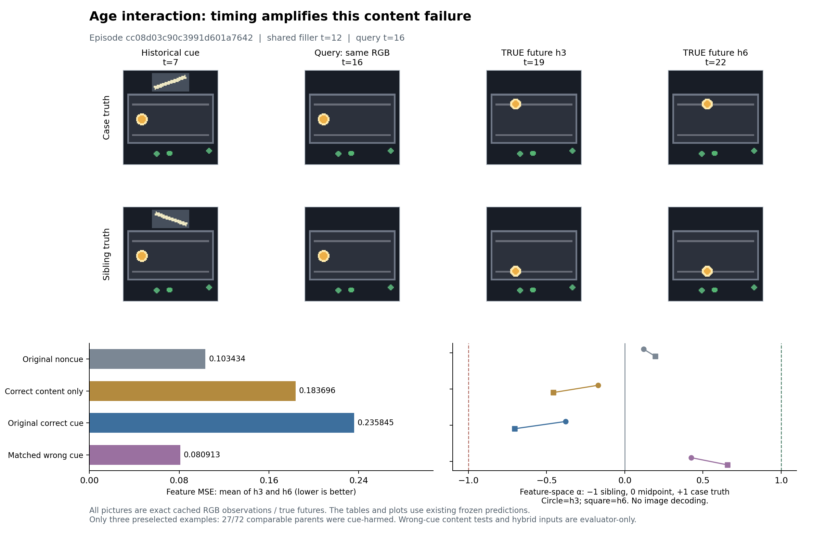
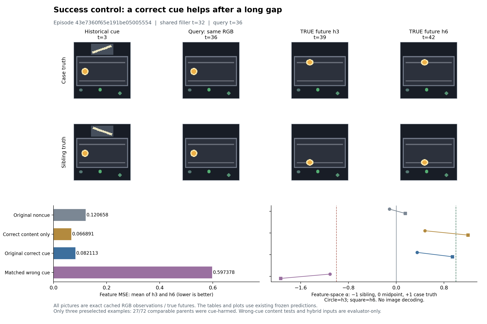

# Gate 真实 RGB 经典案例画廊

[打开交互画廊](../results/literature_diagnosis/visual-casebook-20261022/index.html)：可离线播放两个配对场景的真实轨迹，跳到 cue、query、首次分叉、h3、h6，并查看四种输入条件的真实 MSE 和方向数值。

所有图片都是已有 `unique_rgb.npz` 缓存中的真实 RGB 帧。query 之后显示的是**真实未来，仅用于评估**；本页没有生成、重建或解码任何“预测画面”。特征预测只以数值和图表展示。

## 画面怎么读

早期画面上方有一块短暂出现的斜线图案，它编码 cue。之后 cue 消失；两个 sibling 场景的 recent window RGB 完全相同，小球都停在中央高度。query 之后，小球才分到上/下轨。轨道由 cue 和 query 第一动作共同决定，不能把斜线直接解释成固定指向某条轨道的箭头。

下面三个案例由上一轮完整组合诊断预先固定的数值规则选出：内容伤害最大、年龄贡献最大，以及正确 cue 成功对照。这三例恰巧都是该案例实际走上轨、sibling 走下轨，**不是普遍规律**。

全量背景必须同时保留：192 个已有 development episode 中，72 个实际父集合可以做完整 cue 删除对照；其中 **27/72** 保留 cue 后误差更高。在相同 cue 时间/动作下，正确 cue 相对错误 cue，在这 27 个失败中有 **21 个更差**，但在全部 72 个中仍有 **48 个更好**。三张挑选图不代替这些分布，更不代替独立新场景验证。

## 数值怎么读

每例都展示同一个共享 filler 和 recent context 下的四种条件：

1. **原始 noncue**：原来的不含 cue 子集。
2. **仅换正确内容**：把交换槽换成正确 cue 的特征，年龄和动作仍按原 noncue 设置。
3. **原始正确 cue**：cue 的内容、年龄和动作摘要都来自原 cue。
4. **同时间/动作的错误 cue**：仅把原正确 cue 内容换成 sibling 的 cue；年龄、动作和 filler 完全相同。

主误差是 `0.5*(MSE_h3+MSE_h6)`。设两个真实未来特征的中点为 `m`、半差为 `d`，则 `α=(prediction−m)·d/||d||²`：正确未来在该方向上是 +1，sibling 未来是 −1，中点是 0。α>0 表示预测在这两个特征目标之间更靠近正确分叉；**α 不是实际坐标、图像解码或完整准确率**，正交误差仍计入 MSE。

混合的内容/时间/动作输入只用于诊断，可能不对应真实历史；画廊播放器始终播放原始轨迹，没有为混合输入制作假视频。

## 案例 1：高 attention 也可能读错内容

`bdf81bd672d2a45fbbd832d0`：cue t=4，query t=18，真实未来 t=21、24。

| 条件 | MSE | α h3 | α h6 |
|---|---:|---:|---:|
| 原始 noncue | 0.127822 | −0.1032 | +0.1014 |
| 仅换正确内容 | 0.324210 | −0.9319 | −0.7132 |
| 原始正确 cue | 0.272983 | −0.6887 | −0.6083 |
| 同时间/动作错误 cue | 0.107229 | +0.0825 | +0.2197 |

正确 cue 获得约 **0.999771 attention**，但两个 horizon 的特征方向都偏向 sibling。即使固定 noncue 的时间和动作，只换正确内容也会变差，所以这张图展示的是当前 reader 的内容映射失败，不能仅用“cue 太旧”解释。



[真实双轨 GIF](../results/literature_diagnosis/visual-casebook-20261022/figures/content_harm.gif) · [PDF](../results/literature_diagnosis/visual-casebook-20261022/figures/content_harm.pdf)

## 案例 2：年龄确实会放大某些错误

`cc08d03c90c3991d601a7642`：cue t=7，query t=16，真实未来 t=19、22。

原始 noncue MSE 为 **0.103434**；仅换正确内容为 **0.183696**；恢复 cue 原来的时间与动作后为 **0.235845**；同时间/动作的错误 cue 反而是 **0.080913**。完整组合的端点差距分配为内容 +0.108807、年龄 +0.036611、动作 −0.013007。年龄参与了这个具体失败，但不是唯一解释。



[真实双轨 GIF](../results/literature_diagnosis/visual-casebook-20261022/figures/age_contribution.gif) · [PDF](../results/literature_diagnosis/visual-casebook-20261022/figures/age_contribution.pdf)

## 案例 3：同一预测器的成功对照

`43e7360f65e191be05005554`：cue t=3，query t=36，真实未来 t=39、42。

原始 noncue MSE 为 **0.120658**；仅换正确内容为 **0.066891**；原正确 cue 为 **0.082113**；同时间/动作的错误 cue 上升到 **0.597378**。正确 cue 的 α 为 **+0.3523、+0.9425**，错误 cue 为 **−1.1072、−1.9345**。这说明同一个冻结预测器在另一些场景里确实能够按正确方向使用线索。



[真实双轨 GIF](../results/literature_diagnosis/visual-casebook-20261022/figures/correct_cue_success.gif) · [PDF](../results/literature_diagnosis/visual-casebook-20261022/figures/correct_cue_success.pdf)

## 来源和检查

- 45 张原始 96×96 PNG 逐像素等于缓存，逐帧 SHA256 保存于 [rgb_frames.json](../results/literature_diagnosis/visual-casebook-20261022/rgb_frames.json)。
- 三个 GIF 分别含 25、23、43 帧，每个使用精确的 13 色调色板；完整画布逐帧编码/回读均保持 RGB 一致。
- 所有数值直接取自已经审计的 [完整组合结果](../results/literature_diagnosis/cue-factors-20261022/case_cards.json)，没有新增预测、训练、编码或仿真。
- HTML 自包含，不需要网络。桌面与 390 px 手机布局、15 个关键时间跳转、播放、原始 96×96 图像加载及 JavaScript 错误检查记录于 [render_audit.json](../results/literature_diagnosis/visual-casebook-20261022/render_audit.json)。
- [导出源码](../experiments/phase2/export_gate_visual_casebook.py)、[审计](../results/literature_diagnosis/visual-casebook-20261022/audit.json)、[文件哈希清单](../results/literature_diagnosis/visual-casebook-20261022/manifest.json)。

```bash
OPENBLAS_NUM_THREADS=1 OMP_NUM_THREADS=1 VECLIB_MAXIMUM_THREADS=1 \
  .venv/bin/python experiments/phase2/export_gate_visual_casebook.py
```
