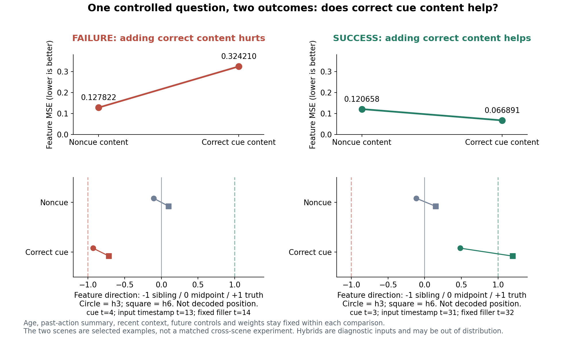
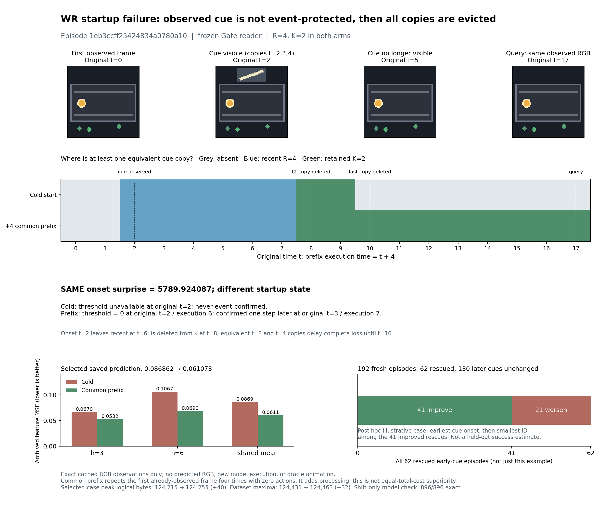
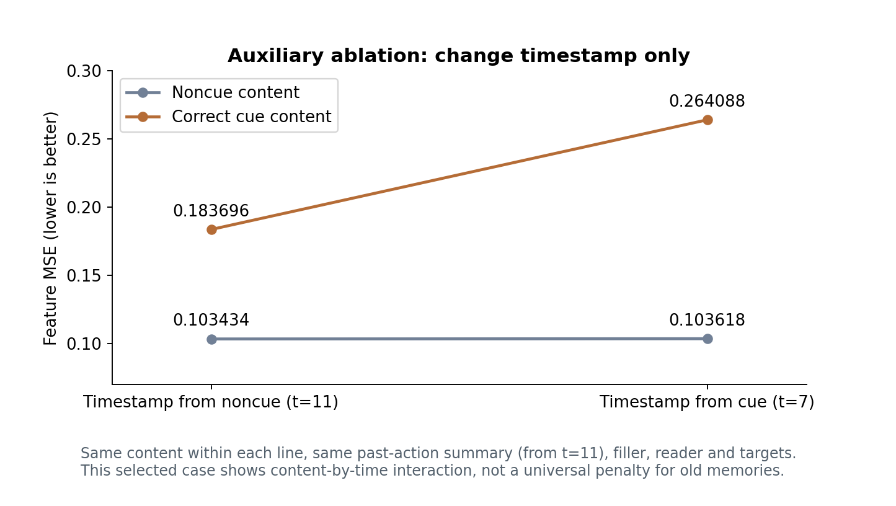

# Gate 案例图册：把失败环节分开看

2026-10-24。[打开新版分组图册](../results/literature_diagnosis/visual-casebook-20261024/index.html) · [配套论文阅读指南](CASE_STUDY_READING_GUIDE_ZH.md) · [10月22日旧图册归档](../results/literature_diagnosis/visual-casebook-20261022/index.html)。

新版先将**内容失败＋成功对照放成一组**，再展示 **WR 启动接纳失败**，时间戳例移到辅助消融。两组仍来自同一个 Gate 视觉任务；不同的是失败发生在哪一环，不是新增了两种视觉环境。原先三个视频形似，不能单凭画面证明三种独立失效机制。

所有 RGB 都是已有缓存中的真实观察。query 之后是**真实未来，仅用于评估**，没有生成或解码预测画面。预测只用已保存的特征向量、MSE 和方向图表示。

## A组：内容失败与成功对照一起看

上方短暂出现的斜线图案编码 cue，之后消失；sibling 配对场景的 recent window 相同。query 之后小球才分到上／下轨。轨道由 cue 和 query 第一动作共同决定，斜线不是直接指向轨道的箭头。选中的失败和成功例恰巧都真实走上轨，不是普遍规律。

每个案例内部固定共享 filler、recent context、预测器和多 horizon 目标；比较如下四种输入。两案例之间不是受控配对，不能将它们的差值解释成某个场景因素的因果效应。

| 输入条件 | 内容失败 MSE | 成功对照 MSE |
|---|---:|---:|
| 原始 noncue 子集 | 0.127822 | 0.120658 |
| 只换成正确 cue 内容，时间／动作仍用 noncue | 0.324210 | 0.066891 |
| 实际正确 cue 的内容、时间与动作 | 0.272983 | 0.082113 |
| 同 cue 时间／动作，只换 sibling 的错误 cue 内容 | 0.107229 | 0.597378 |

失败例 `bdf81bd672d2a45fbbd832d0`：cue t=4，query t=18，目标 t=21、24。实际正确 cue 的 attention 为 **0.999771**，但两个 horizon 的方向 α 为 **−0.6887、−0.6083**，偏向 sibling；相同时间／动作的错误 cue 则为 **+0.0825、+0.2197**。固定 noncue 时间与动作后只换正确内容仍使误差上升，说明不能仅用“cue 太旧”解释。

成功例 `43e7360f65e191be05005554`：cue t=3，query t=36，目标 t=39、42。实际正确 cue 的 α 为 **+0.3523、+0.9425**，匹配错误 cue 为 **−1.1072、−1.9345**。同一个冻结 reader 在这里能够正确利用线索，所以不能宣布整个模型统一学反。

**这组展示的是保存后利用的失败与成功。** 它直接诊断我们的 reader，不是 PaFu 原论文视频扩散系统的复现或反证。内容／时间／动作混搭可能不对应真实历史；图册没有为这些混搭输入制作假视频。

完整分母要一起保留：192个已有 development episode 中，72个实际父集合可作完整 cue 删除对照；**27/72**保留 cue 后误差更高。在相同 cue 时间／动作下，正确 cue 相对错误 cue 在原27个失败里有**21个更差**，但全部72个中有**48个更好、24个更差**。挑选图不替代发生比例或[独立新场景确认](GATE_CONFIRMATION_AND_CASEBOOK.md)。

## B组：WR 启动时未确认事件，随后才完全丢失

已有开发例 `1eb3ccff25424834a0780a10` 在原始 t=2、3、4 都有 cue 副本。t=2 有有效 surprise 分数，但 MAD 阈值尚不可用，因此 cue onset 没有被确认成事件。

- 原始 t=2 的帧在 t=6 离开 recent window，在 **t=8** 被移出保留记忆。
- 其他等价 cue 副本仍在，直到 **t=10** 才全部消失。**t=10 才是完整线索第一次丢失，不能把 t=8 当成完整线索丢失。**
- 所有策略共同收到四帧静止前缀后，同一 onset 在原始 t=3／执行 t=7 被确认。query 是原始 t=17；最终保留集合由冷启动 `[12,13]` 变为前缀 `[2,13]`。
- 已归档的 h3/h6 平均 feature MSE 为 **0.086862 → 0.061073**。这里没有额外计算 α，也没有把前缀干预叫作 oracle。

这是从41个“救回 cue 且 MSE 改善”的已有案例中，按 cue onset、episode ID 排序取首例；属于看过结果后的展示选择，不是独立测试。完整192个开发 episode 中，**62个早期 cue 全部救回：41个改善、21个变差；130个较晚 cue 的保留集合与误差不变**。这也连接A组：保存问题解决后，reader 仍可能用错。

前缀只重复首个已观察帧，新增动作设为0，原轨迹内部相对时间、动作和未来目标不变；896次固定子集时间平移检查的预测差严格为0。R=4、K=2不变，但每条轨迹**额外执行4步**；完整诊断的数据集最大逻辑状态为124,431→124,463字节（+32），本展示例自身峰值为124,215→124,255字节（+40）。不是同总成本策略胜利。

**这组支持适配实现中的短序列启动接纳问题，没有验证“高惊讶动态干扰挤掉低惊讶重要线索”。** [完整启动诊断](WR_STARTUP_DIAGNOSIS.md) · [本例 trace 与成本](../results/literature_diagnosis/visual-casebook-20261024/wr/case.json) · [完整分母](../results/literature_diagnosis/visual-casebook-20261024/wr/summary.json)。

## 辅助消融：固定动作，只改变内容与时间戳

`cc08d03c90c3991d601a7642`：cue t=7，noncue t=11，query t=16。下表中动作摘要都固定为原 noncue 的摘要，filler、recent、预测器与目标也固定；只有槽内容与槽时间戳改变。

| 槽内内容 | 时间戳 t=11（noncue） | 时间戳 t=7（cue） | 只改时间戳的差值 |
|---|---:|---:|---:|
| noncue 内容 | 0.103434 | 0.103618 | +0.000184 |
| 正确 cue 内容 | 0.183696 | 0.264088 | +0.080393 |

时间戳的影响明显依赖内容，所以这张图是A组的**辅助输入消融**，不是第三种独立环境或单独成立的“年龄因果”结论。此前0.183696→0.235845同时恢复了 cue 的时间与动作，不是纯时间戳对照；新版不再用它充当纯时间效果。

## 指标、来源与检查边界

主误差固定为 `0.5*(MSE_h3+MSE_h6)`。两个真实未来特征的中点为 m、半差为 d 时，`α=(prediction−m)·d/||d||²`；正确未来在该轴上是+1，sibling 是−1。α反映这两个特征目标之间的方向，**不是物理坐标、图像解码、规划成功率或完整准确率**；正交误差仍计入 MSE。

本次只重组已归档的证据，没有新模型、编码器、仿真、策略评估或 oracle 搜索。

- A组与时间戳2×2来自[已保存数值](../results/literature_diagnosis/visual-casebook-20261024/reader_cases.json)，底层为[原完整组合结果](../results/literature_diagnosis/cue-factors-20261022/case_cards.json)。45张原始96×96 reader PNG 已与缓存核对；原逐帧信息保留在[旧 rgb_frames.json](../results/literature_diagnosis/visual-casebook-20261022/rgb_frames.json)。
- WR的全部冷启动／前缀步状态来自旧归档；逐帧PNG、驻留状态、首次完整丢失及输入／输出哈希见[provenance.json](../results/literature_diagnosis/visual-casebook-20261024/wr/provenance.json)。
- 新版[导出审计](../results/literature_diagnosis/visual-casebook-20261024/audit.json)与[文件哈希清单](../results/literature_diagnosis/visual-casebook-20261024/manifest.json)区分数据一致性检查和界面检查。静态PNG作视觉检查；自动 `file://` 浏览器导航被安全机制拦截，**没有宣称完成新版浏览器渲染、播放或交互QA**。JavaScript源码检查／DOM模拟也不等于浏览器验收。
- [旧版 render_audit.json](../results/literature_diagnosis/visual-casebook-20261022/render_audit.json)只属于10月22日页面，不能作为新版浏览器验收证据。

阅读顺序及每篇的三个具体分析问题见[配套指南](CASE_STUDY_READING_GUIDE_ZH.md)。
