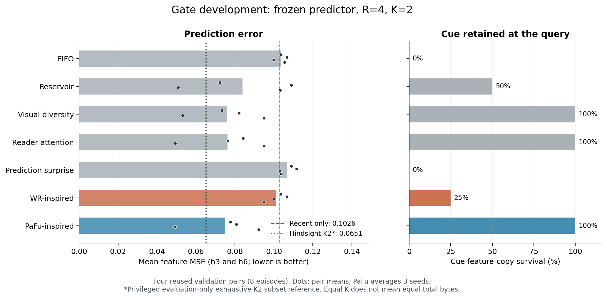
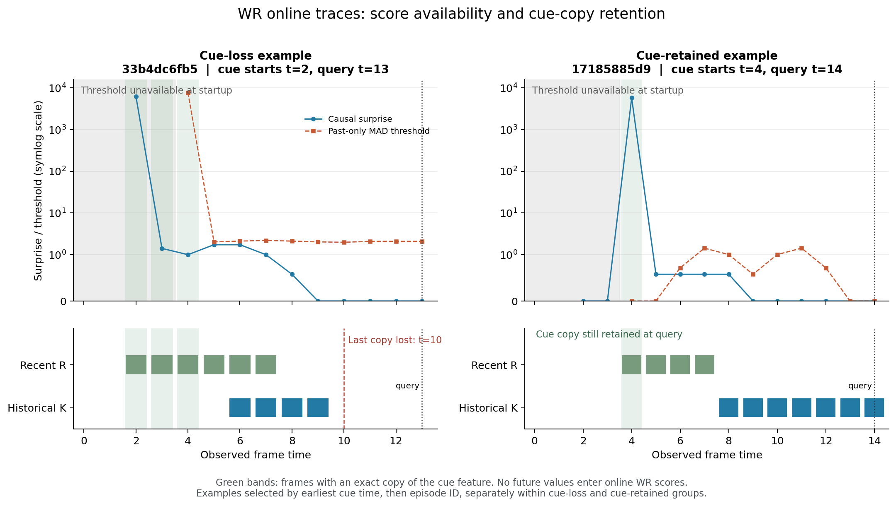

# WR / PaFu 机制适配：开发结果与 bad case

2026-10-22。已完成两个明确标注的机制适配及本地 CPU 开发验证。
当前证据支持继续研究，但不能据此宣称论文复现成功、新场景泛化，或
“已有方法因为不懂未来价值而失败”。两个项目暴露的问题不同。

可核查的 [CV 结果归档](../results/literature_baselines/dev-20261022/README.md)
包含 [冻结协议](../results/literature_baselines/dev-20261022/protocol.json)、
[每个 case 的结果](../results/literature_baselines/dev-20261022/episode_results.json)
及 [来源哈希](../results/literature_baselines/dev-20261022/manifest.json)；
以下图只对已有 dev-v3 结果做可视化，没有新增实验。

## CV：PaFu 有竞争力，WR 的当前失败来自启动阶段

沿用冻结的 Gate 预测器，R=4、K=2，保留的全部 K 项进入同一 reader。
PaFu 学生使用真实 reader 的离线未来注意力标签；仅训练学生，不训练
proposal 自己的删除损失 scorer。WR 使用 Gaussian/MAD/因果峰值机制，
其窗口从原论文的64改为已有 recent buffer 的4，满容量规则单独声明。

训练数据为16对既有训练场景、1,282个候选状态；验证为此前已使用的4对
场景、8个episode。PaFu跑3个初始化种子，因此其24行不是24个独立场景。
以下 MSE 是 h3/h6 的共同均值，越低越好；每次只选一个共同保留集合。

| 在线方法 | MSE | 同一 K+1 parent 的局部 regret | cue 信息保留率 |
|---|---:|---:|---:|
| FIFO | 0.103861 | 0.004618 | 0/8 |
| Reservoir | 0.083809 | 0.006101 | 4/8 |
| Visual diversity | 0.075838 | 0.003669 | 8/8 |
| 当前 reader attention | 0.076198 | 0.006864 | 8/8 |
| 旧 prediction-surprise 控制 | 0.106834 | 0.007687 | 0/8 |
| **WR-inspired** | **0.101216** | **0.007267** | **2/8** |
| **PaFu-inspired** | **0.074942** | **0.005365** | **24/24** |

[矢量 PDF](../results/literature_baselines/dev-20261022/figures/metrics.pdf)。
圆点为四个场景对各自的均值，不能把同一场景的多个种子当成独立样本。

参考值：recent-only 为0.102571；任务定义的 privileged evidence K2 为
0.074275；遍历全部已观察历史二元子集的离线 hindsight K2 最优值为
0.065107。后者可查看未来目标并访问被在线策略丢弃的历史，不能部署。
各策略的局部 oracle 使用各自到达的 parent；局部 regret 的横向差异
不能单独说明某策略全程更好。

cue 持续1–3帧。旧指标只检查标注的第一帧 ID，会把保留同样 feature
的其他帧误记为信息丢失。现在同时记录 start-ID 与精确 feature 副本，
这次修正没有改变任何预测结果。

WR 的6个 cue-loss episode 全部在 t=2或t=3出现 cue。其 surprise 已经
高达约6,028–6,187，但过去的有效 score 不足，MAD threshold 尚未建立，
所以不能确认事件；之后退化为按近期填满 K。t=4出现的2个 cue 则被保留。
**这是明确的启动/阈值 warm-up 问题，不是低惊讶 cue 被动态 distractor
挤掉。** 本批场景的 distractor 是静态的；不能从这批数据证明那个假说。

[矢量 PDF](../results/literature_baselines/dev-20261022/figures/wr_badcase_timeline.pdf)
及 [全部 WR 逐帧证据](../results/literature_baselines/dev-20261022/wr_warmup_trace.json)。
两例分别从 cue 丢失组、保留组按 cue 出现时间及 episode ID 排序选首例，
不按误差大小挑选。

attention、diversity 和 PaFu 都保留了 cue 的精确 feature 副本，却仍有
oracle regret。下一步需区分 cue 的时间/动作上下文、第二个记忆项以及
预测器本身的影响，不能继续统一归因于“没有记住 cue”。

PaFu 学生与离线 attention teacher 在18/24个 query选择同一删除；teacher
平均局部 regret 为0.006248，学生为0.005365。更好地拟合 attention
不一定改善任务误差。这是开发线索，不足以证明某种新监督一定更好。
[逐例 teacher/student 诊断](../results/literature_baselines/dev-20261022/pafu_teacher_diagnostic.json)
保留了各自选择及相同 parent 下的任务损失。

## Predictive-memory：bank 接口还不足以比较论文机制

另轨 BR-0.1 使用已有的96条 L0-derived frozen residual/mask/key 流，
并非完整 L0、RGB 或视觉世界模型。69条用于训练、24条用于开发，边界
3条被排除以隔离训练/开发来源。三个 K 在同样的 R4 与共同动态容量上限
下比较 FIFO、WR、PaFu；A1/A2/A6只作另列参考。

K64 的 POST MPE 如下，越低越好：

| 方法 | EXACT | NEWPATH | CHANGE |
|---|---:|---:|---:|
| 不使用记忆，预测0 | 1.005086 | 0.973741 | 0.946773 |
| FIFO | 1.379673 | 1.356089 | 1.332790 |
| WR-inspired | 1.294593 | 1.381399 | 1.367625 |
| PaFu-inspired | 1.297827 | 1.341295 | 1.340927 |

K4/K16 同样没有超过预测0。每个 K 尝试276个训练 parent，实际产生
非空 future-attention 标签的仅3、4、39个。因此目前没有足够证据把
PaFu 的成绩解释成充分训练后的机制表现。该 reader 是 oracle-key
匹配后的 masked mean，teacher 也退化为 future-only conditional
attention，不具备原论文的双向三组 DiT teacher。

864个局部 oracle parent 均枚举自己的 K+1种删除，129个出现正 regret。
这不是对全部历史 K 子集的穷举，也不是全局最优在线策略；其未来6步
冻结 bank、不继续写入。出现 gap 不能自动证明策略可以从当前信息学到
oracle答案，且改进可能只是删除有害旧值。

## 下一步及不可越过的结论边界

1. 新视觉场景需要独立、预先固定的验证协议；本报告没有 fresh 结果。
2. WR 的下一项诊断应明确隔离 warm-up：例如在独立协议中加入正常的
   启动上下文，同时给所有方法相同输入。不要对这4对结果反复调阈值。
3. 对已经保留 cue 的策略，先分析同一 parent 下 teacher、学生与任务
   oracle 的差异，再判断 proposal 的未来任务价值监督有多少可学空间。
4. PM bank 当前首先是 reader/teacher覆盖不足的负面诊断。完整输入未
   补齐前，不能把它当成原始 A2 的公平替代，更不能宣布新记忆机制胜出。

CV 的两种适配保持同 K，但动态状态与学生权重并不等大：PaFu另有
82,308参数字节。PM 的共同 reserved envelope 是上限，不是实际分配；
PaFu另有44,548参数字节。均不声称同总字节或同计算量。A2使用此前从
完整 Z 生成的冻结 gates，而本 bank 没有 Z，二者输入不等价。

所有当前结果来自本地 CPU。训练/验证重复使用、仅4对CV场景、单种子PM
以及开发集CHANGE相邻来源相关，均限制推断强度。完整数值与审计口径以
[dev-v3 summary](../results/literature_baselines/dev-20261022/summary.json)
及独立 PM 仓库的 `br-0.1-dev-seed17` 结果文件为准。
