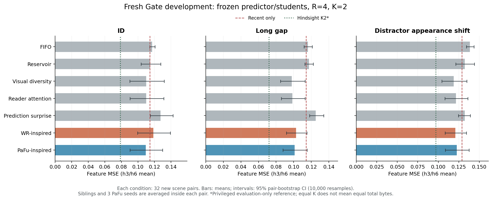
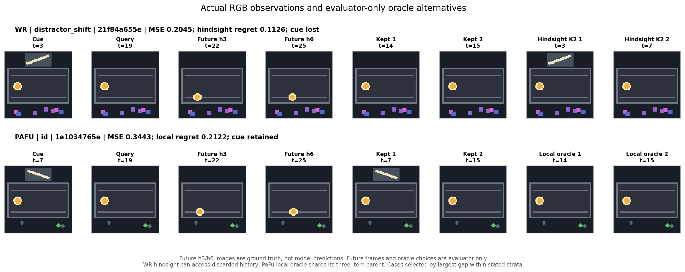

# 新 Gate 场景：baseline、oracle 与 bad case

2026-10-22（纽约时间）。这轮已完成真实 A100 编码，以及本地 CPU 冻结预测器评估。
主要结论：**发现了可核查的 bad case，但目前最关键的问题不只是记忆丢失。**
WR 的早期 cue 失败与阈值 warm-up 完全对应；attention/PaFu 大多已经保留 cue，
仍有 oracle gap，而且部分 oracle 会主动删掉 cue 才获得更低的 feature MSE。
这要求先核查预测器/reader 和评价目标，再把 gap 当作新记忆方法的收益空间。

[完整归档](../results/literature_baselines/fresh-20261022/README.md) ·
[冻结协议](../results/literature_baselines/fresh-20261022/protocol.json) ·
[逐例结果](../results/literature_baselines/fresh-20261022/episode_results.json) ·
[独立数值审计](../results/literature_baselines/fresh-20261022/audit.json) ·
[统计和 CI](../results/literature_baselines/fresh-20261022/statistics.json)

## 本轮实际做了什么

- 重新生成 96 对场景、192 个 episode：ID、long gap、distractor appearance shift 各32对。
  共5,782帧，1,440张不同RGB；新 seed 与旧数据的 scene seed 不重合。
- 冻结原有 I-JEPA、旧训练集 normalization、预测器、PaFu 三个学生（seed17/23/41）。
  没有重新训练、拟合新 normalization、选 checkpoint 或训练 proposal 的 utility scorer。
  本轮按已固定的旧模型协议完成，没有切换新 handoff release 的模型。
- 所有策略共用 R=4、K=2 和全部 K 项读取；WR/PaFu 都明确是机制适配。
  WR 的 resident Gaussian 窗口为4，原论文为64；PaFu 使用当前真实 additive reader 的
  离线未来注意力代理，不是原论文 DiT/QKV 的完整复现。
- 每个 query 用同一个 K2 子集共同预测 h3/h6。局部 oracle 枚举当前同一 K+1 parent
  的3种删除；hindsight oracle 遍历全部已观察历史的 K2 子集，使用评估端未来目标。
  后者可以访问已经丢弃的历史，不能在线部署。

A100 job **10097** 在 `b-19-17` 以 `COMPLETED / 0:0` 结束；实际 CUDA 设备为
`NVIDIA A100-SXM4-40GB`，UUID与 `nvidia-smi` 对上。
**分配了143 GPU-seconds**，encoder 程序129.22秒，其中编码40.03秒；申请4 CPU、
实际分配12 CPU。后续预测与 oracle 枚举在本地 CPU 用时334.59秒。
[执行凭据](../results/literature_baselines/fresh-20261022/hpc-execution-receipt.json)和
[原始终端截图](../results/literature_baselines/fresh-20261022/a100-completed.png)分别保留。

## Baseline 结果

下表是 h3/h6 feature MSE 的共同均值，越低越好。PaFu 先在同一场景内合并三个固定种子。

| 方法 | ID | Long gap | Distractor shift |
|---|---:|---:|---:|
| Recent-only（参考） | 0.114415 | 0.114073 | 0.128827 |
| FIFO | 0.117287 | 0.116313 | 0.138640 |
| Reservoir | 0.114958 | 0.117285 | 0.132321 |
| Visual diversity | 0.110115 | 0.097902 | 0.118881 |
| Reader attention | 0.110059 | 0.098540 | 0.121591 |
| 旧 prediction-surprise 控制 | 0.127432 | 0.125108 | 0.132268 |
| **WR-inspired** | **0.118781** | **0.102637** | **0.120981** |
| **PaFu-inspired** | **0.109488** | **0.100987** | **0.122507** |
| Privileged evidence K2（参考） | 0.110006 | 0.097673 | 0.119013 |
| Hindsight K2 最小损失（不可部署） | 0.078868 | 0.072033 | 0.097117 |

[矢量 PDF](../results/literature_baselines/fresh-20261022/figures/fresh_metrics.pdf)。
CI按每个 condition 的32个场景对做10,000次 bootstrap；先合并 sibling 和学生种子，
不会把192条 PaFu seed-row 当作192个独立场景。CI只描述这些冻结学生下的场景抽样不确定性，
属于探索性分析，未做多重比较校正。

PaFu 并未稳定胜过已有强控制。以下为 **PaFu − 对照** 的配对 MSE 差及95% CI；
负值表示 PaFu 更好，六个区间都包含0。

| 对照 | ID | Long gap | Distractor shift |
|---|---|---|---|
| Reader attention | −0.000571 [−0.003915, 0.002261] | 0.002447 [−0.001048, 0.006471] | 0.000916 [−0.000805, 0.002722] |
| Visual diversity | −0.000627 [−0.004321, 0.002750] | 0.003085 [−0.002502, 0.008772] | 0.003626 [−0.000926, 0.009176] |

这些结果支持把 PaFu 保留为有竞争力的机制基线，不能支持“训练后的策略已经优于强 baseline”。
局部 regret 依赖各策略已到达的 parent，不能跨策略仅比较这个数值就排序全程优劣。

## WR：新数据再次定位到 warm-up，而非动态 distractor

[完整逐帧分类](../results/literature_baselines/fresh-20261022/wr_classification.json)
使用真实 Gaussian score、过去 MAD 阈值、事件确认时间，以及精确 feature 副本。

| Cue 出现时间 | Episode 数 | Cue 保留 | Cue 丢失 |
|---|---:|---:|---:|
| t=2或3：出现时阈值未建立 | 62 | 0 | 62 |
| t=4–7：阈值已建立 | 130 | 130 | 0 |

早期 cue 的原始 surprise 约5,617–6,270，并不低；缺的是已初始化的阈值。
三条件下 WR 的保留率分别为48/64、42/64、40/64，其丢失数量分别等于早期 cue 数。
因此当前明确的 failure mode 是这份因果、短窗口适配的启动行为。
`distractor_shift` 改变干扰物外观，场景内干扰物仍是静态的；本轮没有验证
“后来高惊讶动态 distractor 挤掉低惊讶 cue”这个假说。

## 保留 cue 仍失败：oracle 有时主动删除 cue

Reader attention 与 visual diversity 都在192/192个 episode 保留了 cue；
PaFu 在572/576条 episode-seed 行保留了 cue。attention 有116条、PaFu 有375条
**已经保留 cue 但局部 regret 仍为正**。所以不能把所有 gap 解释成遗忘。

进一步枚举“至少保留一个 cue 精确副本”和“不保留 cue”的所有 K2 子集后发现：

| 条件 | Hindsight 最优保 cue | Hindsight 严格偏好不保 cue | 对应 pair-bootstrap 比例95% CI |
|---|---:|---:|---|
| ID | 46/64 | 18/64 | 28.13% [15.63%, 40.63%] |
| Long gap | 49/64 | 15/64 | 23.44% [12.50%, 35.94%] |
| Distractor shift | 51/64 | 13/64 | 20.31% [10.94%, 29.69%] |

这里的“严格偏好”比较两个集合的最低损失，容差1e−8，排除了仅由并列最优的
排序造成的假象。总计 **46/192** 个 episode 的 feature-loss 最优子集不含 cue。
在 baseline 已保 cue 的行中，attention 有27/192条、PaFu 有88/572条，其同一 parent
的局部 oracle 也严格偏好丢掉 cue；PaFu 的88条仍包含重复种子，不能当作88个独立场景。
[每个 episode 的 oracle 审计](../results/literature_baselines/fresh-20261022/oracle_enumeration_audit.json)
及 [PaFu 每个 parent 的三种损失](../results/literature_baselines/fresh-20261022/pafu_teacher_diagnostic.json)可追溯。

这提示 reader/预测器或 feature MSE 与物理任务证据之间存在不一致；它不是对某个成因的最终诊断。
**Oracle 的 feature MSE 更低，不等于物理预测、规划或任务成功率更正确。**

另一个尚未核实的边界是 **因果可学性**：本轮没有证明 oracle 的选择能从保留策略允许的
past-only 输入预测出来。一般而言，相同的可观察历史若对应不同的未来动作或目标，
就可能产生相互冲突的 oracle 标签；即使 oracle gap 稳定存在，也不代表过去信息足以
恢复它。这是接下来需要检验的可能性，不是声称本轮已经找到这种冲突。
结合当前 reader/目标失配，现有结果还不足以支持立即训练自己的 utility scorer。

## Teacher/student：不只是学生没学好 attention

离线 attention teacher 与学生在468/576条 query选择同一删除。

| 条件 | 相同删除 | Teacher 局部 regret | Student 局部 regret | Student − teacher MSE [95% CI] |
|---|---:|---:|---:|---|
| ID | 149/192 | 0.021918 | 0.021499 | −0.000419 [−0.002769, 0.001963] |
| Long gap | 153/192 | 0.014356 | 0.016576 | 0.002220 [−0.000756, 0.005678] |
| Distractor shift | 166/192 | 0.010021 | 0.009294 | −0.000728 [−0.001993, 0.000259] |

差值三个 CI 都跨0；更关键的是 teacher 自己也存在正 regret。
进一步提升 teacher imitation 不会自动解决 attention 目标与任务损失的分歧。
这为 proposal 的 future-task-utility 监督提供了具体待检验问题，尚不是已证明的收益。

## 两个实际 RGB case

[矢量 PDF](../results/literature_baselines/fresh-20261022/figures/fresh_rgb_badcases.pdf) ·
[选择规则、候选损失与 RGB 哈希](../results/literature_baselines/fresh-20261022/bad_cases.json)。
图片均来自保存的真实 RGB，经 `records.json` 索引到原始 frame；future 图是 ground truth，
不是预测器生成的图片。选例是探索性的最大 gap case，不能据此推断发生率。

1. **WR / `21f84a655e94f3fb25aab8a6`**：t=3 的 cue 在阈值建立前出现，后来已丢失。
   query时留下[14,15]，MSE=0.204490。局部 parent=[13,14,15] 已没有 cue，局部 regret=0；
   全历史 hindsight 能恢复[3,7]，MSE=0.091865。这说明只在最终 query 优化当前删除，
   无法恢复早先不可逆丢失的信息。
2. **PaFu seed17 / `1e1034765eacf2913409528e`**：parent=[7,14,15]，t=7是 cue。
   teacher给 cue 概率0.672683，teacher/student都留[7,15]，MSE=0.344255；
   同 parent 的 oracle 留[14,15]，MSE=0.132021，局部 regret=0.212234。
   在这个 case，问题不是没保存 cue，也不是学生偏离 teacher，而是当前注意力/预测损失的分歧。

## 历史是否有用：内容被使用，但收益并非三条件都稳定

用 sibling 的错误 cue 替换 privileged K2 中的历史证据，保持目标、recent、动作不变。
“错误历史 − 正确历史”的三个 CI 都严格大于0，支持预测器确实在使用历史内容。
但“正确 privileged evidence − recent-only”只有 long gap 的 CI 不跨0。

| 条件 | 正确历史 − recent-only [95% CI] | 错误历史 − 正确历史 [95% CI] |
|---|---|---|
| ID | −0.004408 [−0.023885, 0.016193] | 0.082289 [0.034591, 0.130540] |
| Long gap | −0.016400 [−0.030236, −0.000828] | 0.121904 [0.076906, 0.164912] |
| Distractor shift | −0.009813 [−0.023308, 0.005319] | 0.119677 [0.080354, 0.157572] |

因此，“历史被读取”和“历史稳定改善预测”要分开陈述。
这个 privileged 控制是指定 evidence + 最新 filler，并非经过 loss 优化的 K2 最优集合。

## 成本与核验

| 在线策略 | 最大动态逻辑字节 | 额外学生参数字节 | 平均在线 ms/episode |
|---|---:|---:|---:|
| FIFO | 123,614 | 0 | 2.58 |
| Reservoir | 123,628 | 0 | 2.74 |
| Visual diversity | 123,626 | 0 | 11.23 |
| Reader attention | 123,619 | 0 | 33.29 |
| Prediction surprise | 131,465 | 0 | 77.57 |
| WR-inspired | 124,431 | 0 | 14.92 |
| PaFu-inspired | 123,619 | 82,308 | 31.23 |

这些是逻辑状态与新增学生权重，非进程峰值RSS；共同的冻结模型不在此表重复计入。
同 K 不等于同总字节、训练成本或计算量。CPU计时受场景长度和执行环境影响，不能作为受控速度排名。

独立导出审计验证了392个数据 artifact 哈希，精确重算1,728行、两个 horizon 的 MSE
（最大差0），核对41,670个在线 trace事件；验证1,728个同 parent 的3选2局部 oracle，
以及192个 episode 合计44,696个历史 K2 子集。另重算192条错误历史控制的预测损失。
检查未调用模型或产生新训练。[导出源码与哈希清单](../results/literature_baselines/fresh-20261022/manifest.json)
保留全部来源，模型和大数组未放入 portable 归档。

## 周一与 Saining 讨论的重点

1. **先确认任务价值监督要学什么。** 46个 episode 的 feature-loss oracle偏好不保 cue，
   是当前 predictor 的校准/读取问题，还是 feature MSE 与任务指标不一致？在未核清前，
   不能把所有 hindsight gap 当成 memory policy 的可实现收益。
   同时需核查 past-only 可学性：在策略可见的相同或匹配历史输入下，未来不同是否产生
   冲突的最优删除？当前没有做这项诊断，不能从“稳定 oracle gap”自动推出“可学习的改进”。
2. **分离两类 bad case。** WR warm-up 是在线写入/事件确认问题；保 cue 仍有 regret 是
   reader、记忆项组合、时间/动作上下文或目标失配问题。后续比较需同时报告保留率和任务误差。
3. **下一步仍按 proposal。** 先以固定、共同输入的独立诊断隔离启动阶段；核查官方 handoff
   模型及 baseline planning 后，再决定在哪个冻结 predictor 上训练 train-only utility scorer。
   不把这轮结果反复用于调阈值，不更换 reader 来制造优势；保留 attention/diversity 强控制。
4. **诚实表述范围。** 这轮是同一生成器上的新 development 场景、feature prediction诊断，
   不是真实 PushT 闭环规划结论，也不是原论文的完整复现。PM 的 residual-bank 负面诊断
   仍是独立轨道，不能与这里的视觉结果合成一个胜负结论。

[早期四对场景的 dev-v3 快照](LITERATURE_BASELINE_DEVELOPMENT_REPORT.md)保留用于追溯，
本文件是随后新增场景的结果，不替换或追改早期观察。

后续更新（2026-10-22）：上述待核查问题已继续做 WR 共同前缀控制、同 parent 的
reader／metric 分解、past-only 固定 probe 与输入支持域控制。请读
[综合诊断及与旧 PM 案例的连接](BASELINE_ORACLE_DIAGNOSIS_20261022.md)。
本报告保留最初运行时的结果和判断，不将后续探索追写为预先提出的结论。
