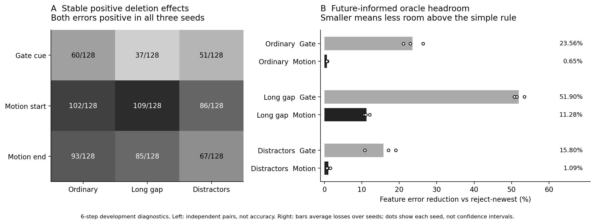

# Next step before learning a retention policy

## Decision and scope

**Decision:** check whether deletion costs are useful beyond a timestamp shortcut before spending time learning a scorer. The current exploratory diagnosis is complete; an age-counterbalanced candidate-pool implementation has passed software preflight. No new predictor, retention policy, model forward pass or fresh confirmation was run. Added GPU usage: **0 seconds**.

This keeps the original acceptance rules and all previous failures unchanged. It does not turn the existing development set into an independent test set.

## Alternatives considered before the new analysis

| Candidate | Information gained | Cost and main limitation | Decision |
|---|---|---|---|
| Retrain the predictor again | Could improve absolute forecasting | More development tuning; does not isolate memory-deletion value | Defer |
| Train a retention scorer immediately | Could test deployability | Existing newest-entry shortcut and limited ordinary Motion headroom confound the interpretation; policy training is outside the current authorization | Defer |
| Inspect per-pair stability, baseline headroom and timestamp confounding | Distinguishes average evidence from reliable labels and task opportunity | Uses revealed data and aggregated forks; cannot prove learnability | Execute first |

SPACE [1] is a close methodological reference for frozen multi-horizon counterfactual eviction under a fixed memory budget. Here we borrow the separation between candidate consequences and policy decisions, without claiming a SPACE reproduction or a new retention method. Literature checking reopened the design choice: removing a benchmark shortcut is more informative now than adding scorer complexity.

## What was executed

`tools/diagnose_signal.py` reads the existing 11,520 pair-level scalar records and descriptive baselines. It checks input hashes, aligns the same pair across seeds 17/29/43, and reports:

- Positive, tied and negative critical-minus-nuisance errors per pair, seed, horizon and metric.
- The number of pairs with positive effects in **both errors and all three seeds**, keeping the pair as the denominator.
- Cross-seed rank correlations, with undefined correlations reported as null.
- Remaining improvement from reject-newest to the future-feature oracle. These are descriptive mean gaps; marginal baseline intervals cannot supply paired intervals for their difference.
- An exhaustive clock-construction check over the configured start, duration and gap ranges.

The sign tolerance is 1e-12 for numerical ties, not a new acceptance threshold. No new pass rule replaces the registered 10% effect and confidence requirements.

### Finding 1  The original pools contain an age shortcut

In **1,596/1,596 legal parent constructions**, the newest entry is a nuisance frame. This follows from the code's pool construction, not a sampled estimate. Thus reject-newest systematically avoids the designated critical evidence. The original deletion effects remain valid within those pools, but they do not isolate semantic value independently of age.

### Finding 2  Aggregate success does not mean every label is stable

Pairs with positive critical-minus-nuisance effects in both metrics and all three seeds, at six steps:

| Evidence role | Ordinary | Long gap | Distractor shift |
|---|---:|---:|---:|
| Gate cue | 60/128 | 37/128 | 51/128 |
| Motion start | 102/128 | 109/128 | 86/128 |
| Motion end | 93/128 | 85/128 | 67/128 |

These are descriptive agreement counts, **not prediction accuracies or replacements for T5 coverage**. Averaged Motion effects can pass while some individual scenes or seeds disagree. Labels are also averages over sibling episodes and two parent variants, not individual deletion events.

### Finding 3  The available headroom depends strongly on condition

Six-step reduction in feature error from reject-newest to a future-informed feature oracle, calculated from seed-averaged losses:

| Task | Ordinary | Long gap | Distractor shift |
|---|---:|---:|---:|
| Gate | 23.56% | 51.90% | 15.80% |
| Motion | 0.65% | 11.28% | 1.09% |

For Motion the corresponding task-error reductions are 2.79%, 3.83% and 4.34%. A feature-selected oracle is not a task-error oracle. These gaps have no newly computed paired confidence interval and do not establish attainable past-only performance. The larger Gate gap may partly exploit predictor errors; it is not proof of reliable preservation of task evidence.



Left: each cell counts independent scene pairs with positive effects in both errors for all seeds. Right: bars are headroom calculated from seed-averaged feature losses; dots are individual seeds, not confidence intervals. Both panels use six-step development results.

## The next actual inference study

The prepared code is `experiments/counterbalanced_pools.py`. **Its new pools have not yet been evaluated by the frozen predictor.** They reuse real historical timestamps and require no new encoding if the original caches are available.

1. **Gate age counterbalance:** put the cue at the oldest, middle and newest chronological position in otherwise three-entry parents. Delete one item in each fork; always retain two, with the same recent frames and actions. Exclude the rest of the cue window. Small RGB fixtures verify that the selected non-cue observations are identical across paired siblings. Cue timing is privileged pool-construction metadata and must never enter a learned model input.
2. **Motion clock-only pools:** draw six unique triples from all legal historical timestamps without evidence, visibility, hidden-state or future information. Keep all sampled pools, including uninformative ones. Earlier visible Motion frames cannot be falsely called nuisance merely because they precede the annotated start. These are static candidate-pool diagnostics, not a sequential streaming policy.
3. Reuse all six frozen predictors and current readouts. Record candidate timestamps, each deletion's losses and paired baseline differences. Retain per-pair baseline losses so oracle headroom can receive a paired uncertainty interval.
4. Compare FIFO, reject-newest, uniform deletion and the future-informed oracle in every predeclared pool group. Report zero-signal pools and feature/task disagreement rather than removing them. Analyze both original horizons and all conditions; do not choose a favorable seed or condition after seeing results.
5. Decide whether a **separately authorized scoped policy pilot** is worth running. A material oracle advantage that survives age counterbalancing is necessary evidence, but still does not prove that a past-only scorer can learn it. Joint readiness and original Phase1_GO remain false unless their own criteria are met. Fresh 9137 stays closed.

### Adversarial checks and remaining limitations

This is one AI-assisted analytical pass, not an independent reviewer panel. The important counterarguments are preserved: stable labels may be unlearnable from legal inputs; oracle advantages may exploit model error; privileged Gate pools are not deployable; random Motion pools may contain little usable evidence; and all current observations come from already revealed development data. If the revised pools show negligible headroom, improve the benchmark's evidence/value variation before training a more complex policy.

## Reproduce

```bash
python tools/diagnose_signal.py
python tools/diagnose_signal.py --check
# Optional figure, after installing requirements-report.txt:
python tools/plot_signal_diagnosis.py
python -m pytest -q
```

Machine-readable results are in `results/diagnostics/`. Existing scientific sources, original outcomes, report files and GPU ledger are unchanged.

## Sources and assistance

1. Niu et al. (2026). [SPACE Sparse Predictive Attractor via Counterfactual Eviction for Streaming Video Memory](https://arxiv.org/abs/2609.32592). Closest-work reference, checked 16 October 2026. This bounded search does not establish novelty.
2. Kassis, T., Agarwal, V., He, Y., Patel, D., & Brueckner, A. M. (2026). [Scientific Agent Skills A Library of Procedural Knowledge for Research Agents](https://doi.org/10.48550/arXiv.2609.00065). The scientific-brainstorming workflow assisted alternative generation and decision logging; it did not validate the hypothesis. Current record checked 16 October 2026.
