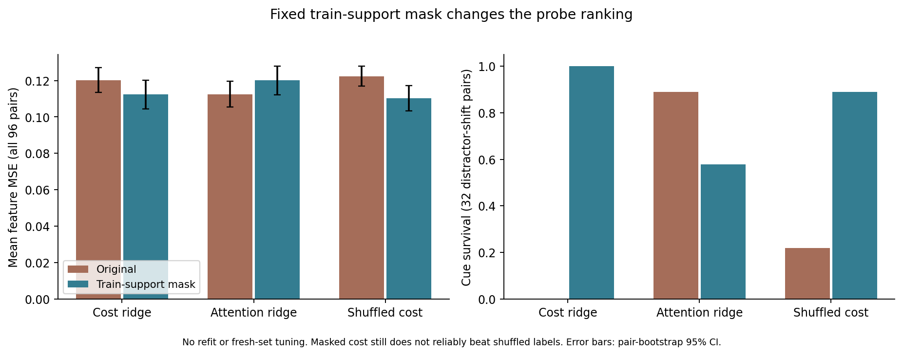

# Oracle 决策能否从过去信息学到：2026-10-22 诊断

**当前没有证据证明 deletion-cost 标签已经学到了比强 baseline 或打乱标签更可靠的保留规则；也不能据此说 oracle 不可学习。** 本轮发现两件不同的事：一是关键线索丢失以后，完全相同的有界记忆确实会需要不同的 oracle 删除动作；二是小型线性探针的训练支持不足，近零方差标准化让新场景的分数严重外推。消除后一种数值因素后，cost 与 attention 的排名反转，但 cost 仍未可靠超过 shuffled-label 对照。

这是按 proposal 的“先检查可学习的 baseline–oracle 缺口”进行的**离线可行性诊断**。本轮确实用旧 TRAIN 标签拟合了三个线性探针；不能表述为“没有训练任何删除打分器”。这些探针没有被采用为最终方法，没有替换现有 baseline、预测器或 checkpoint。

## 固定的实验边界

- 数据：旧 Gate TRAIN 的 16 对、32 条轨迹，使用已有五类策略提供的**全部 1,282 个 K+1 父集合**。与 fresh 的 96 对、192 条轨迹无 ID/配对重叠。Fresh 已在前一轮分析中看过，因此属于开发集，不能叫未触碰的测试集。
- 三个目标：真实删除损失；离线 future-attention；每个父集合内随机打乱的删除损失（固定 seed 17）。后两者是同容量对照，attention 没有使用删除损失训练。
- 架构完全相同：903 个线性系数，父集合内中心化，TRAIN-only RMS 标准化，固定 ridge λ=1。输入包含当前/候选/近期视觉投影、相互作用、时间年龄及已经执行的动作摘要。没有未来观察、未来动作、证据标注、条件或 episode ID 输入。三个模型合计不是一项策略；每个模型各有 14,456 字节系数、尺度和标量。
- 目标始终为一次共同删除动作对应的 `L = (MSE_h3 + MSE_h6)/2`。没有按 horizon 选择两个不同动作。
- 评价包含 **1,121 个原 baseline 产生并去重的相同父集合**，以及三个探针各自在 R=4、K=2 下不可恢复的在线重放。在线重放不会从历史档案找回已删项目，结尾只通过冻结的子集损失缓存计分。
- 置信区间：先平均一条轨迹内的多个父集合，再平均配对中的两条轨迹，以 96 个独立生成配对为 bootstrap 单位（5,000 次，固定 seed 20261022）；分条件为 32 对。不是把 1,121 个父集合当独立样本。
- [原始协议](../results/literature_diagnosis/learnability-20261022/protocol.json)先于标签生成/拟合写入，绑定源码、数据、basis、normalization 和 epoch-35 预测器。只运行本地 CPU；没有新编码或预测器训练。

## 1. 真正的信息丢失：有界状态相同，完整过去不同

逐字节哈希比较了实际输入，而非仅比较隐藏状态或任务名称：完整的已观察 normalized-feature 前缀和已执行动作；候选/近期记忆、时间戳及动作摘要；最后才比较探针投影输入。

| 审计对象 | 跨轨迹相同状态 | oracle 最优删除冲突 |
|---|---:|---:|
| 完整已观察前缀，且候选集合相同 | 0 | 无法由本数据建立完整过去的不可辨识性 |
| 原始有界观察状态 | 231 组（462 行） | 217 组 |
| 探针投影输入 | 与上面相同的 231 组 | 相同的 217 组 |

这 231 组均有不同的未来目标；217 组冲突的**实际未来动作完全相同**，因而不是动作计划差异导致的冲突。冲突判据是所有样本的最优动作集合没有交集，数值容差固定为 `1e-8`。完整过去不相同，关键线索原本可以被看到；碰撞发生在保留策略已将其丢失之后。

在这些重复状态的经验分布上，单次确定性状态选择器的最低平均遗憾为：

`min_d mean_i L_i(d) − mean_i min_d L_i(d) = 0.00281477`。

这是**针对相同有界状态、固定一次决策**的经验下界；不是整个在线策略、所有因果方法或总体数据分布的不可学习性证明。更早保留线索可以避免进入同一个状态，也可以改变后续候选集合。

最大的例子有相同候选 `[8, 9, 29]`：

| 轨迹 | 删 t8 | 删 t9 | 删 t29 | oracle |
|---|---:|---:|---:|---|
| `5ae31de7436280f574b87bd9` | 0.133864 | 0.135640 | **0.110532** | 删 t29 |
| `a277142f01078cf0ad1831d0` | **0.096360** | 0.097553 | 0.116129 | 删 t8 |

此例任何共享删除动作的平均额外误差至少为 0.00988425。选择规则、完整状态哈希、动作哈希和损失均在 [bad_cases.json](../results/literature_diagnosis/learnability-20261022/bad_cases.json)；全集在 [ambiguity.json](../results/literature_diagnosis/learnability-20261022/ambiguity.json)。它提示应定位**首次不可逆丢失**，而非只在最终失败时刻训练更复杂的 selector。

## 2. 原始探针失败，但失败受数值外推影响

原始 cost 探针 TRAIN 的最优删除命中率只有 38.07%，平均 regret 0.007674；attention 是 30.58% / 0.012765，打乱标签是 35.18% / 0.011709。训练拟合本身不强，不能把 fresh 失败简单解释成“oracle 没有可学信号”。

检查输入后发现 903 列中有 **710 列的 TRAIN 父集合内 RMS 触及 1e-6 下限**。其中既有中心化后理应抵消的共同上下文，也有旧训练数据几乎不支持的视觉投影/交互坐标；它们在新场景中不再接近零。Fresh 标准化输入范数中位数为约 958,026，旧 TRAIN 为 11.45。ID/long-gap/shift 超过 TRAIN 范数第 99 百分位的候选比例分别约 56.4%/52.2%/61.9%。不能把这些异常分数当作正常泛化失败。

因此只追加**一个预先记录的数值诊断**：[support-mask 协议](../results/literature_diagnosis/learnability-20261022/support_mask/protocol.json)。对三个原模型都把 `TRAIN RMS <= 1e-6` 的同一批 710 列系数置零；不重新拟合，不改阈值/λ，不增加可见信息，数组形状和分配字节数不变，有效非零系数数目减少。Mask 完全由旧 TRAIN 输入决定，但追加这一诊断的动机来自已看过的结果，因此如实标为事后探索；两个版本一起报告，不选择较好的版本作为确认结果。

原 cost/attention 的父集合分数跨度中位数为 42.22 / 634.58，其中被置零列单独贡献的跨度为 38.17 / 625.21。Mask 后仍有 6.56 / 4.48 的跨度，仍明显大于损失标签的变化尺度；这个控制只隔离最明显的近零方差因素，**没有证明其余输入移位已被解决**。Mask 改变了 34.0% 的 cost、26.0% 的 attention 父集合决策。

## 3. 两个版本共同支持什么结论

下表是不可恢复的在线重放，MSE 越低越好。

| 探针/控制 | 原始 MSE | support-mask MSE |
|---|---:|---:|
| Cost ridge | 0.120286 | 0.112316 |
| 同容量 attention ridge | 0.112479 | 0.120131 |
| Shuffled-cost ridge | 0.122339 | **0.110272** |
| 原有 reader-attention baseline | 0.110064 | 不修改 |
| 原有 diversity baseline | 0.108966 | 不修改 |
| 原有 PaFu（3 seed 平均） | 0.110994 | 不修改 |

Mask 使 cost 在 distractor-shift 的线索存活从 **0/64 变为 64/64**，这是原版本明显受外推影响的直接证据。然而：

- 原 cost−attention 为 **+0.007807**，95% CI `[+0.001029, +0.014638]`；mask 后变为 **−0.007814**，CI `[−0.015363, −0.000233]`。符号反转说明只报告任一版本都容易误导。
- 原 cost−shuffled 为 **−0.002053**，CI `[−0.007966, +0.003882]`；mask 后为 **+0.002045**，CI `[−0.001354, +0.005576]`。**两版均未建立 cost 标签优于打乱标签的证据。** 单个固定 null seed 也不等于完整 permutation test。
- Mask 后 cost 相对原 reader-attention 多 0.002253 MSE，相对 diversity 多 0.003350，二者配对 CI 均跨零。不能因为击败同容量 attention 探针，就声称已经击败 proposal 的强基线。

在相同父集合上，原 cost / masked cost / masked null 的 regret 分别为 **0.013861 / 0.010460 / 0.009687**，最优动作命中率为 **34.96% / 36.29% / 37.63%**。原 diversity regret 是 0.010344、命中率 39.53%。以 FIFO regret 0.014883 为分母，cost 捕获其 oracle gap 的比例从 6.87% 升到 29.72%，但 masked null 为 34.91%；以 diversity 为参照，masked cost 的捕获率仍为 −1.11%。这些比率为点估计，不能替代上面的配对差异区间。

Oracle 标签也有许多小 margin：1,121 个父集合的最优/次优差中位数 0.002614；333 个不超过 0.001、76 个不超过 0.0001，只有一个低于 1e-6，均高于固定 1e-8 容差。因此不能将所有失败都归于浮点平局，但只看 top-1 准确率也会放大小损失差异。本轮同时报告 regret 和严格动作冲突，没有根据 fresh 的 margin 选择过滤阈值。

## 4. 根据 proposal 下一步该做什么

1. 先与同一轮的[预测器/指标诊断](BASELINE_ORACLE_DIAGNOSIS_20261022.md)合并判断，确认监督损失确实奖励任务证据，而非冻结 reader 的偶然偏差。不要把“oracle 删除 cue”直接转成训练目标并期待学出研究方法。
2. 若继续学标签，首先在 TRAIN 上确认可拟合程度与输入支持；固定表示、支持处理和 λ 的选择规则以后，另生成未看过的配对做确认。不能在这 96 对上反复改模型后继续称其新验证。
3. 针对已证实的状态碰撞，把分析移到线索首次出现/首次被丢弃的时刻。比较当时的可见线索、WR 接纳和强 baseline 行为，区分“此前可以避免的遗忘”与“当前同状态确实无法区分”。
4. 在稳定超过 shuffled-label 和强 baseline、且任务指标一致之前，**不把当前 ridge 探针升级成 proposal 的正式 deletion-utility 方法**。单个简单模型失败只限制该容量/目标/输入组合；既不是因果可预测性证明，也不是不可学习性定理。

## 复现、审计与边界

入口为 `experiments/phase2/diagnose_oracle_learnability.py`；数值控制为 `diagnose_oracle_learnability_support.py`。两个 `export_oracle_learnability*.py` 只审计与导出，不拟合模型。原始 v2 CPU 运行 32.28 秒（拟合 0.87 秒），mask 重放 16.52 秒；独立导出审计另计。14,456 字节是每个探针新增的固定数值参数成本；在线结果还逐轨迹记录了历史项/动作摘要/计数器的逻辑动态内存与延迟，不包含 Python/Torch 分配器等运行时开销，不能把系数字节误报成整个系统成本。

原始结果、参数和 source snapshot 在 [learnability-20261022](../results/literature_diagnosis/learnability-20261022/README.md)，控制在 [support_mask](../results/literature_diagnosis/learnability-20261022/support_mask/README.md)。两次独立审计核对全部 3,363 个 common-parent 选择、576 个 query 损失、13,890 个不可恢复轨迹事件及配对区间；mask 审计还重新计算了全部 **10,434 个在线删除动作**。旧 TRAIN 1,282 行因果输入逐行重建，ridge 正规方程残差低于 1e-10；future 输入扰动、split guard、候选置换、碰撞判据和配对权重有单元测试。

完整 binary training arrays / traces 保留在被忽略的 `build/literature-diagnosis-20261022/` 并由 summary/manifest 哈希绑定；portable JSON 保留标量结果、参数、全部候选损失与输入/源码来源。v1 只因配对内多个父集合的权重修正而由 v2 取代，逐例选择和拟合没有变化；不隐藏原始负结果或事后数值控制。
