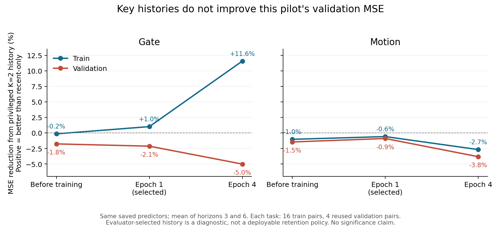
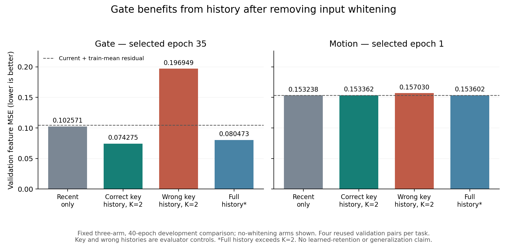

# Fresh predictor history-use and training diagnosis

The original four-epoch Gate/Motion predictors respond to historical content,
but their historical conditioning does not improve validation MSE. A subsequent
fixed three-arm, 40-epoch comparison found a useful Gate candidate: removing input
whitening permits lower error with correct history, while replacing that history
with the paired scene's evidence sharply increases error. Motion still lacks a
net history benefit. No learned retention policy has been evaluated.

These are newly trained development models, not a reproduction or rejection of
the teammate's unavailable final repaired models. All work in this diagnosis and
follow-up ran on CPU using the previously downloaded frozen I-JEPA features.

The audit uses the original downloaded A100 features and checkpoints, with their
hashes checked before use. It opens train/validation arrays only, preserves all
original artifacts, and never fits a transform on validation data. Each task has
16 training pairs and four repeatedly used validation pairs. These are exploratory
development results, not a fresh generalization test.

## Does the predictor use history?

The same saved model is evaluated with recent-only, all historical observations,
privileged key observations at K=2, and matched sibling-history replacements.
Siblings have identical recent observations and actions. The replacement changes
only historical content; simulator state never enters the model. Privileged
timestamps are evaluator-only controls. Full history exceeds the training memory
budget and is an information reference, not a fair retention competitor.

The following figure concerns the **original four-epoch pilot** only:



Three quantities have different meanings:

- **Sensitivity:** predictions change when historical content is replaced.
- **History benefit:** correct history has lower error than recent-only.
- **Correct-evidence advantage:** correct history has lower error than the matched
  wrong history.

Sensitivity alone establishes dependence, not useful prediction. The saved epoch-4
Gate model improves training MSE from 0.109124 with recent-only to 0.096513 with
privileged history; wrong history gives 0.125562. On validation, however,
recent-only gives 0.104790, privileged history 0.110045, and wrong history
0.107191. The learned training preference does not transfer to these validation
scenes. The selected epoch-1 checkpoints also have worse validation MSE with
privileged history: Gate 0.107056 versus recent-only 0.104819, and Motion 0.154848
versus 0.153466.

The diagnostic recomputes all six initial validation scores **bit-exactly** for
both tasks. Saved trained models replay within cross-runtime floating-point
tolerance. It contains 2,400 episode/horizon records, 120 aggregate cells, and
paired contrasts with the pair as the independent unit. These counts are not
independent trials or success percentages.

## Why did ordinary validation MSE rise?

### The optimized objective differs from the selection metric

Training minimizes `MSE + 2 * pair_MSE + 0.5 * rank_loss`; selection uses plain
MSE. Writing the two sibling errors as their mean `c` plus/minus difference `d`,
ordinary MSE is `mean(c²) + mean(d²)`, while the first two training terms become
`mean(c²) + 9 * mean(d²)`. This strongly weights distinguishing siblings.

For the original frozen Gate model, validation common-mode error increased by
0.000497 while difference error fell by 0.000118, yielding a net MSE increase of
0.000379. The combined validation objective nevertheless improved. Motion has
the same direction of objective-versus-MSE disagreement. Thus the MSE rise is not
proof that optimization made no progress.

Matched four-epoch controls with the same seeds, samples and order show that
removing rank loss, or using MSE alone, also worsens validation MSE. The objective
tradeoff is real, but rank loss alone is not a sufficient explanation or fix.

### Whitening amplifies unsupported input directions in Gate

Gate centered normalized-feature RMS is nearly equal between train/validation
(0.387/0.385). Unwhitened PCA RMS is also similar (2.449/2.287). After the saved
whitening transform, the values become 0.606/4.531. Of 128 coordinates, 81 have
training second moment below 1e-4 but contribute 77.97% of validation projected
energy. The original transform can multiply a PCA direction by up to 20.

A posthoc development intervention masks those coordinates using training data
only, without changing any model parameter or buffer. Gate six-mode validation
MSE falls from 0.107931 to 0.105669, while training MSE is effectively unchanged.
This directly identifies a harmful contribution from the unsupported directions.
It does not solve history generalization: masked recent-only still scores better
than masked privileged or full-history conditioning. Motion has no inactive
coordinates at this threshold, so the intervention does not change Motion.

Disabling whitening changes the first-epoch MSE slope slightly, but the matched
four-epoch trial does not beat the current-feature plus train-mean residual
baseline. The longer fixed comparison below establishes a useful Gate candidate
on this development split. It does not establish an independently validated
remedy or resolve Motion.

### Small data and the sampled histories limit training evidence

Across the original four epochs, Gate FIFO and temporal buckets never retain an
observation that differs between siblings at the scored query. Random-fixed and
reservoir histories expose such differences only about 19% and 14% of the time;
visual diversity does so about 89%. This is an evaluator-only coverage analysis,
not evidence timestamps supplied to training. Some training examples cannot
distinguish the two futures from their legal inputs.

The initializer already predicts the current feature plus a train-fitted mean
future residual and a neural correction. It is not a random-guess baseline. The
current-plus-mean reference achieves validation MSE 0.104471/0.153490 for
Gate/Motion. The original selector chose the best *trained* epoch and did not
consider epoch zero; the new bounded follow-up explicitly includes epoch zero.

The retained predictor architecture directly reads the current frame and
aggregates old history. It does not aggregate the other three recent frames into
its output. This is an existing architecture limitation, not a new sampler bug;
the diagnosis has not silently changed that architecture.

## Proposal-aligned continuation

The fixed three-arm learning-curve comparison is complete: original whitening,
unit-column projection (no whitening), and masking training-unsupported
coordinates, each for 40 epochs / 240 optimizer steps per task. All six runs use
the same optimizer, objective, sampled histories, seed, architecture and output
basis. Initial, selected and terminal checkpoints remain separate. Selection
uses the earliest minimum six-mode validation MSE, **including epoch zero**.

| Task / input projection | Selected epoch | Initial MSE | Selected MSE |
|---|---:|---:|---:|
| Gate / original whitening | 0 | 0.107552 | 0.107552 |
| Gate / no whitening | 35 | 0.105936 | **0.097827** |
| Gate / training-support mask | 0 | 0.105423 | 0.105423 |
| Motion / original whitening | 0 | 0.154291 | 0.154291 |
| Motion / no whitening | 1 | 0.154595 | 0.154453 |
| Motion / training-support mask | 0 | 0.154291 | 0.154291 |

This metric averages six training-sampler modes; it is distinct from the six
online retention-policy evaluation and the history controls below.

| Selected no-whitening model / validation input | Gate | Motion |
|---|---:|---:|
| Recent-only | 0.102571 | **0.153238** |
| Full history (information reference) | 0.080473 | 0.153602 |
| Privileged K=2 history (evaluator only) | **0.074275** | 0.153362 |
| Wrong sibling K=2 history | 0.196949 | 0.157030 |
| Current feature + train-mean residual | 0.104471 | 0.153490 |

Gate's privileged history reduces error by **27.6% relative to recent-only**;
the wrong-history intervention reverses the gain. Motion is sensitive to history,
but correct history still does not beat its recent-only condition. This supports
a Gate-only development continuation; Motion remains a predictor diagnostic.



The full comparison took 55.64 seconds on CPU. Independent artifact review checked
51 executed source hashes, six run outputs, 18 checkpoint states, training-only
projection derivation and epoch-zero-inclusive selection. Recomputing 720 control
metrics from saved vectors reproduced every value exactly. No test arrays were
opened and original inputs were unchanged. A first attempt with excessive BLAS
threading was stopped and retained; the completed retry changes only BLAS thread
limits, not scientific parameters.

The protocol was fixed before this follow-up, **after exploratory validation had
already been inspected**. It is not a preregistered confirmation. Four independent
validation pairs per task are too few to establish held-out generalization. The
27.6% figure is an evaluator-history control, not learned-retention performance.

Any changed predictor requires newly bound baseline results and newly generated
deletion labels. Old labels must not be relabeled as coming from a new model.
The [Gate continuation](PHASE2_GATE_FOLLOWUP_CONTINUATION.md) has now executed that
step: six policies on eight validation episodes produced 96 horizon losses;
118 distinct bounded-memory states produced 354 equal-K deletion forks and 708
losses. Of the parents, 94 are training and 24 validation. Independent review
recomputed every saved loss and checked continuous irreversible replay. Diversity
and attention have mean h3/h6 MSE around 0.076, compared with FIFO around 0.104;
they must be treated as strong competitors, not replaced with an easy baseline.

The next method experiment under the proposal is a past/present-only
set-conditioned scorer trained on the new Gate deletion labels, with the
same-capacity attention-target scorer as its supervision control. Evaluation
must retain irreversible online updates and strong baselines. Independent
trajectory/seed and delay/distractor evaluation is still required before a
generalization claim. Motion remains under diagnosis rather than being passed
through as a successful prerequisite. The conditional 5,000–10,000 trajectory
expansion is not automatically required by the proposal.

Independent [PushT data preparation](PHASE2_PUSHT_PLANNING_PREPARATION.md) has
collected 48 episodes (32 train / 8 validation / 8 evaluation), with 4,656 frames
per masked/unmasked variant. It preserves ordered absolute XY actions and applies
occlusion before encoding. Goal images, feature encoding, an action-compatible
predictor, history-necessity validation and baseline-model planning remain to be
completed. Data collection and interface tests do not establish planning.

These are prerequisite diagnosis and Phase 2 development work. Scorer training
belongs to Phase 3. No additional T8, 12-model confirmation or numerical success
threshold is imposed as a new proposal requirement.

Final software validation passed 229 tests with zero failures, errors or skips,
plus dependency checks, both historical evidence verifiers and the actual PushT
interface. Software checks and scientific model results are separate receipts.

## Reproduction

From the repository root, after restoring the independently verified local
development archive:

```bash
.venv/bin/python experiments/phase2/diagnose_history.py \
  --snapshot build/hpc-20261020/development-assets \
  --output build/NEW_HISTORY_DIAGNOSTIC

OPENBLAS_NUM_THREADS=1 VECLIB_MAXIMUM_THREADS=1 \
.venv/bin/python experiments/phase2/diagnose_training_objective.py \
  --snapshot build/hpc-20261020/development-assets \
  --output build/NEW_OBJECTIVE_DIAGNOSTIC

OPENBLAS_NUM_THREADS=1 VECLIB_MAXIMUM_THREADS=1 \
.venv/bin/python experiments/phase2/train_predictor_followup.py \
  --snapshot build/hpc-20261020/development-assets \
  --output build/NEW_FIXED_PROJECTION_COMPARISON
```

The relocation adapter does not rewrite original absolute-path manifests. It
checks the fixed export index, each consumed file, checkpoint/cache/basis identity,
retained model source, and original bytes again after execution. Prediction
vectors, model binaries and raw datasets stay in ignored `build/`; portable
summaries and plots are published in
[`results/phase2_history/20261020`](../results/phase2_history/20261020).
`python tools/verify_phase2_history.py` checks the published evidence and numerical
claims; it does not rerun models or replace the full raw-artifact audits.
