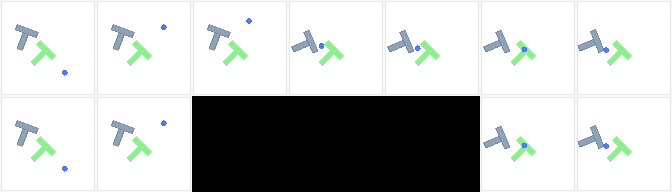

# Actual frozen I-JEPA and PushT interface validation — 20 October 2026

**Completed on local Apple MPS, not on an A100.** The real official frozen I-JEPA
encoder processed both variants of the actual PushT trace. This closes the RGB →
pre-encoding occlusion → frozen visual features interface check. It does not
complete baseline-model planning, validate memory necessity, or establish a
prediction/retention performance result.

Portable evidence is in
[`results/phase2_local_mps_encoder/summary.json`](../results/phase2_local_mps_encoder/summary.json).
The full local run is `build/phase2-pusht-ijepa-mps-20261020-http`; model weights and
full RGB/feature arrays remain outside Git. No historical Phase 1 data/checkpoint
was required for this interface run, and no historical source file was edited.

| Verified item | Actual result |
|---|---|
| Official model | `facebook/ijepa_vith14_1k` |
| Immutable revision | `f157467ea509bc356ff9f61fd3c0d840eec5e04e` |
| Device and precision | Apple MPS, float32; CPU operator fallback disabled |
| Encoder state | All modules in eval; 0 trainable parameters; parameter versions unchanged |
| Parameter count | 630,762,240 |
| Pooling and output | Four spatial cells; finite `(25,5120)` float32 features per variant |
| Paired controls | Same seed/actions; matching features on visible frames |
| Occlusion | Full RGB blackout at t=8–12 before encoding; masked/control features differ |
| Later visible targets | Query 11/12 with recent4 masked, horizons 3/6 visible |
| Model weight integrity | Full 2,523,108,984-byte safetensors SHA-256 matches the official cache blob identity |



Top row: unoccluded control. Bottom row: actual encoder input. Columns correspond
to timestamps 0, 7, 8, 11, 12, 13 and 17. The same trace was encoded by the real
frozen model; random collection actions are **not** planning actions.

Three bounded attempts were retained:

1. The initial preflight failed after 10.86 seconds because Transformers 5.5.4
   required Torchvision for `AutoImageProcessor`, including the PIL backend.
   Compatible Torchvision 0.29.1 was installed alongside Torch 2.14.1.
2. The Xet download was stopped after 142.61 seconds without downloaded weight
   bytes; the whole child process group was terminated and interruption recorded.
3. Standard official Hugging Face HTTP transport (`HF_HUB_DISABLE_XET=1`)
   downloaded the same pinned weights and completed encoding/verification in
   471.69 seconds. This includes download time; separate inference timing was
   not measured.

Total child-process runtime was 625.16 seconds, within the 1,200-second combined
budget. The final run manifest includes source/configuration hashes, package
versions, transport choice, hardware identity, verification results and artifact
hashes. The official model/config/processor hashes were additionally verified
after execution. No predictor or retention scorer was trained; no A100 execution
or baseline-model MPC success is claimed by this record.

To repeat this **local MPS** check with a fresh output directory:

```bash
HF_HUB_DISABLE_XET=1 .venv/bin/python experiments/phase2/run_local_mps_encoder.py \
  --output build/phase2-pusht-ijepa-mps-NEW \
  --cache-dir build/model-cache --timeout-seconds 1200
```

The separate `run_encoder_pilot.py` remains CUDA/A100-only. This local result
does not replace its hardware verification or change its execution requirements.
