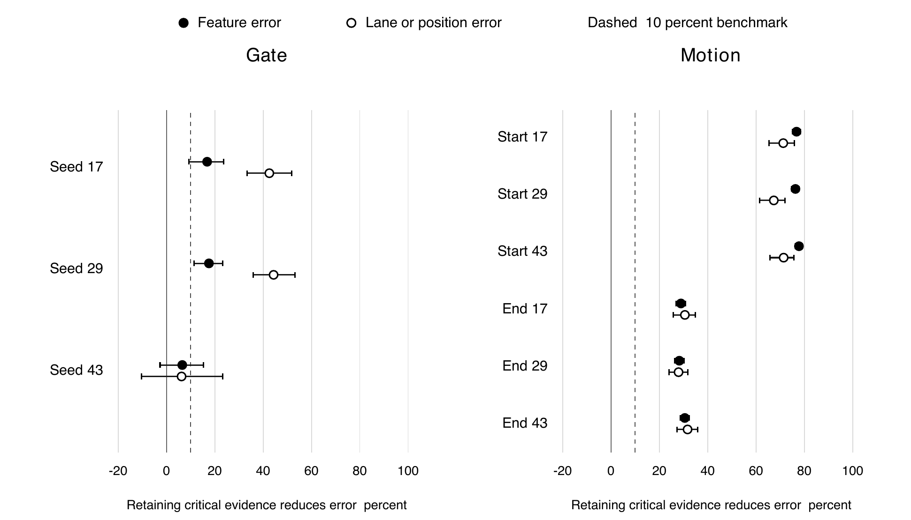

# Results and limitations

The latest full predictor experiment is native job 7574, evaluation 7575, and independent scalar audit 7576. All six models completed 120 epochs / 7,680 steps. This proves execution completion; the strict development criteria were not met.

| Evidence | Gate | Motion |
|---|---:|---:|
| T1 Feature evidence | 3/3 | 3/3 |
| T2 History benefit | 23/24 | 8/24 |
| T3 Historical-content response | 24/24 | 24/24 |
| Original counted total T1+T2+T3 | 50/51 | 35/51 |
| T4 Fixed-reference checks | 32/32 | 8/32 |

The 24 comparisons use three conditions × two horizons × four summaries (three seeds and their mean). These overlap; they are not 24 independent datasets. Gate also has two long-gap h6 full-history degradation warnings outside the 51-count denominator. Their intervals include no change, so they are warnings rather than demonstrated significant harm.

At Motion long-gap h6, two key memories reduce feature MSE by only about 1.5%, with a paired interval spanning approximately −1.5% to 4.6%. It also regresses against the older two-memory predictor in the designated hard slice. Reliable extraction of past motion direction does not imply accurate long-occlusion position prediction.

## Equal-capacity deletion assay

The assay used six frozen models, 128 base pairs per task/condition, horizons 3/6, and three seeds. Native scalar auditing covered 55,296 raw fork/horizon rows. Six transferred CSVs contain 11,520 pair-level rows and permit independent recomputation of 180 scalar statistics without models or GPU use.

| Condition | Gate critical contrasts | Motion critical contrasts | Cross horizon Gate / Motion |
|---|---:|---:|---:|
| Ordinary | 4/6 | 12/12 | 6/6 and 6/6 |
| Long gap | 0/6 | 12/12 | 6/6 and 6/6 |
| Distractor shift | 2/6 | 12/12 | 6/6 and 6/6 |
| Total | 6/18 | 36/36 | 18/18 and 18/18 |

Positive values favor retaining critical evidence. Black points measure feature error and white points task error; bars are paired uncertainty intervals. Gate seed 43 is unstable. Motion's start and end evidence consistently carry relative deletion value in these constructed pools.

Motion supports only a scoped feasibility interpretation. Reject-newest has ordinary h6 feature MSE 0.116061 versus 0.115305 for a future-feature oracle, just 0.65% descriptive headroom. This is not proof that a learned policy can beat simple rules.

**Registered joint policy-stage readiness: not met. Original full Phase1_GO: false. Fresh independent confirmation and learned-policy advantage: not run.**

## Primary records

- [Predictor outcome](../results/predictor/evaluation/job_7575/outcome.json)
- [All 64 fixed-reference comparisons](../results/predictor/all_64_fixed_checks.csv)
- [Deletion summary](../results/deletion/summary.json)
- [Independent deletion audit](../results/deletion/independent_audit.json)
- [Required reference evidence](../results/reference/verification.json)

Only the latest complete evidence and required reference dependencies remain in this tree. Earlier unsuccessful or incomplete experiments are retained in Git history; cleanup does not change their outcomes or the latest acceptance criteria.
