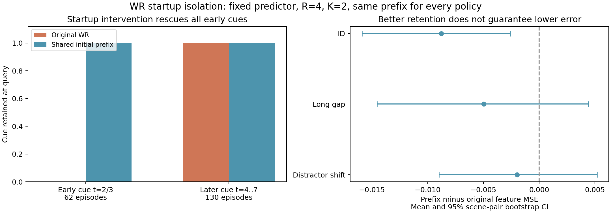

# WR 启动问题：已用共同输入干预隔离

2026-10-22，纽约时间。**目前 WR 丢掉早期 cue 的直接原因，是短序列开始时
Gaussian/MAD/峰值确认所需的历史尚未建立。** 在不增加任务信息、不给 WR
特殊预算、也不调阈值的固定诊断下，原先丢失的62个新场景 cue 全部被保留。
但其中21个场景的 feature MSE 反而变高，因此“修好保存”仍不等于“预测正确”。

## 干预如何保持可比较

每段轨迹的第一个已观察帧复制4次，放在原轨迹前；所有原始时间戳、query、
cue 一起平移4步，复制段的已执行动作设为0。原轨迹内部的相对年龄、过去动作
累计、未来动作和 h3/h6 目标均不变。**WR、FIFO、reader attention、visual
diversity 都收到相同前缀**；R=4、K=2、原冻结预测器和 WR 参数全部不变。

4步由既有 tracker 的2帧 Gaussian 最小历史和2个有效分数的 MAD 启动需求
事先固定；没有根据本次误差搜索前缀长度或阈值。协议写在第一次 replay 前。
这是假设已有一小段静止起始观察的诊断干预，增加了处理步数；它不是重新定义
原始数据上的 baseline，也不算新的未见测试集或原论文的完整复现。

完整集合为旧训练32个 episode 加上此前的新开发192个 episode，共224个、
4策略×2输入版本=1,792行。旧训练只作机制检查，没有拟合任何参数。
[协议及归档](../results/literature_diagnosis/wr-startup-20261022/README.md)
保留每个案例与全部 WR 逐步标量状态。

## 结果：启动原因得到干预支持

| Fresh cue 时刻 | Episode 数 | 原始 WR 保住 cue | 共同前缀后保住 cue |
|---|---:|---:|---:|
| t=2/3 | 62 | 0 | **62** |
| t=4–7 | 130 | 130 | **130** |

62个早期 cue 在原始输入中均没有可用阈值、没有被确认为事件；前缀后均建立了
阈值并确认为事件。130个较晚 cue 的最终保留集合与误差完全不变。旧训练轨迹
也呈相同规律：6个早期 cue 从全部丢失变为全部保留，其余26个不变。

对同一个原始保留集合整体平移时间，**896次冻结模型检查的预测差严格为0**。
这排除了“只是改了时间编码或未来目标使模型误差降低”的解释。原始输入下
768行 fresh 四策略结果也与之前的发布结果逐行完全相等。

FIFO 与 diversity 在全部224个 episode 的保留集合及 MSE 都不变。
Attention 有223个不变；一个 long-gap episode 的 filler 从原始 t=1 换成 t=0，
cue 在两边都保留，MSE 从0.057883变为0.065167。前缀确实可能影响早期容量路径，
因此报告这个控制差异，不把它宣称为对所有策略都完全没有作用。

## 保存修好之后，预测误差仍需要单独解释

下表采用同一保留集合预测 h3/h6 的 feature MSE 均值；CI 先合并 sibling，
再按每条件32个独立场景对 bootstrap 10,000次。

| 条件 | 原始 WR | 前缀 WR | 前缀−原始，95% CI |
|---|---:|---:|---|
| ID | 0.118781 | **0.110006** | −0.008775 [−0.015883, −0.002572] |
| Long gap | 0.102637 | **0.097673** | −0.004964 [−0.014544, 0.004423] |
| Distractor shift | 0.120981 | **0.119013** | −0.001968 [−0.008973, 0.005206] |

原始62个早期失败中，41个在保住 cue 后 MSE 降低，**21个反而升高**。
最明显的升高例是 `f82d6aadd9356608d63e1a63`：0.152615→0.269736。
这个例子是按最大的升高选出，只用来定位问题；发生比例仍以完整62个为准。
不能把它解释为“cue 不重要”，也不能以特征误差直接代替物理状态或规划质量。

前缀 WR 在三个 fresh 条件的均值恰好等于既有 privileged cue+最新 filler
控制；它恢复了这批静态干扰场景里的简单 cue 保存行为，却没有建立超越强
attention/diversity 的优势，也没有检验后来的高惊讶动态干扰是否会挤掉有用信息。

## 成本、证据与下一步边界

CPU运行35.44秒，无GPU、新编码或新训练。R+K仍只有6个表示，复制帧没有留在
最终长期记忆中。WR 最大逻辑状态从124,431增至124,463字节，多出的32字节
来自额外标量分数历史；增加处理步数也增加时间，不能声称同总成本。

独立导出检查精确重算1,792行×2个 horizon 的 MSE，验证所有原始 fresh 行、
896个时间平移对照以及完整的有界 WR trace。参数、预测器源码和旧数据保持
原哈希。[核查结果](../results/literature_diagnosis/wr-startup-20261022/audit.json)
与 [逐例对比](../results/literature_diagnosis/wr-startup-20261022/paired_policy_comparisons.json)
可直接追溯；3个软件测试覆盖共同前缀、动作/目标不变和早晚 cue 的启动行为。

按 proposal，这项结果把“观察到了却没保存”的问题从“已经保存但模型/损失
不正确利用”的问题中分离出来。后续仍应先完成 reader/任务指标和 oracle
过去可学性诊断，不基于这192个已看过的场景继续调阈值，也不把 warm-start
诊断自动替换为最终 baseline 或新方法。
